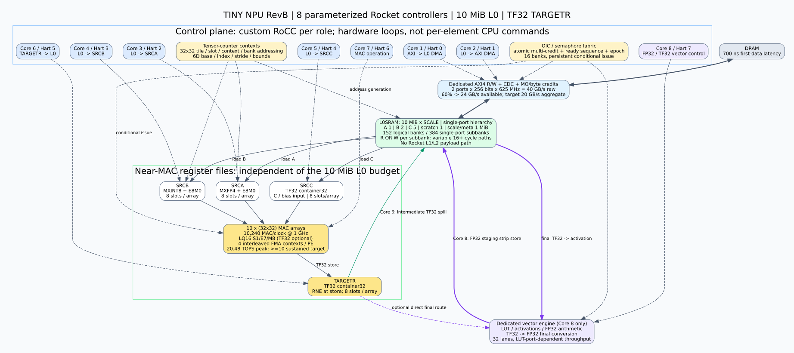
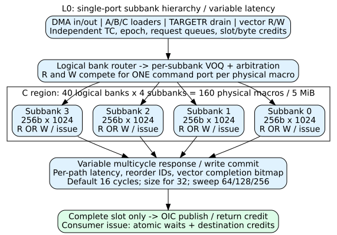

> 최신 FMA latency/context/RF 설정과40-gate 수용 기준은 [FMA pipeline 보고서](FMA_PIPELINE_REPORT.md)를 우선 적용한다.

# TINY NPU Architecture RevB — 8 Rocket Controllers / 10 MiB L0 / TF32 TARGETR

> 최신 trace·DRAM 700ns 정의·초기 합성은 [검증 문서](WORKLOAD_VERIFICATION.md)와 [실행 결과](WORKLOAD_REPORT.md)를 우선 적용한다. 이전 성능 표는 계획 모델이며 실제 RTL 성능이 아니다.

기준일: 2026-11-01(KST). 개발 위치: [jhroh13/chipyard, tiny-npu](https://github.com/jhroh13/chipyard/tree/tiny-npu).

**상태: 새 구조의 HDD·명령 계약이다. 기존 4-core Rocket 설정과 R2 stream-GEMM RTL을 이 구조로 모두 교체·통합한 상태는 아니다.** TF32 format 및 single-port multicycle SRAM primitive를 별도 구현·검증하며, 기존 FP32 R2 테스트는 별도 기준으로 보존한다.

## 1. 확정 사항과 남은 수치 결정

- 사용자가 기본 **Rocket 8개**, 코어 수 파라미터화를 확인했다. 문서의 Core1..8은 Hart0..7에 대응한다.
- AXI↔L0SRAM, L0↔SRCA/SRCB/SRCC/TARGETR를 전용 데이터 경로로 분리한다. Rocket L1/L2는 코드·스택·호스트 제어용이며 matmul payload를 경유시키지 않는다.
- L0 기본10 MiB, 목표 성능에 따라 확장한다. 여기서 MiB는2^20bytes이다.
- TARGETR는 **TF32 저장**이다. 기본은32-bit container: sign1/exponent8/fraction10/low13zeros이다. Packed19는 별도 비트패킹 설계가 필요하므로 초기 구현 범위에 넣지 않는다.
- **Core8/Hart7**만 FP32/TF32 벡터·변환 명령을 소유한다. Core1..7의 데이터 이동 명령은 부동소수 값을 해석하지 않고 opaque payload를 이동한다.
- 최종 출력은 Core8의 vector/convert 경로가 TF32→FP32로 변환해 L0에 저장한다. Core2가 그 FP32 버퍼를 DRAM으로 전송한다.
- SRCC는 TF32 container32의 초기C/부분합/bias 입력을 기본으로 제안한다. FP32 외부 C/bias는 Core8이 TF32로 준비한 뒤 publish한다. SRCC의 bias broadcast와 기존C load는 descriptor flag로 구분한다.
- **확정:** MAC 내부 FP32 누산은 사용하지 않는다. 기본 저정밀 모드는 사용자 지정 `S1/E7/M8` 16-bit(LQ16), 선택 고정밀 모드는 TF32(S1/E8/M10)이다. TARGETR 저장은 항상 TF32이며 최종 FP32 변환은 Core8이 수행한다. M8은 숨은 비트를 제외한 fraction8bits, exponent bias63을 기본 정의로 둔다.

TF32→FP32 container 변환은 정밀도를 복구하지 않는다. TF32는FP32와같은exponent 범위이나유효fraction이10bits이다.32-bit container에서는L0/DRAM전송량이FP32보다줄지않는다.

## 2. 구조 다이어그램



[SVG](architecture.svg) · [PNG](architecture.png) · [수정 가능한 Graphviz](architecture.dot)

굵은 실선은payload, 점선은제어/주소/동기화 경로다. TC/OIC는각엔진의분산프론트엔드에구현하고공유counter fabric과연결한다. 한중앙블록이모든메모리beat를순차처리하는구조가아니다.

## 3. 8개 Core와 전담 엔진

| Core / Hart | 담당 | 전담 hardware engine | 완료 시점 |
|---|---|---|---|
| 1 / 0 | AXI→L0 | DMA read, AR/R, reorder, byte credit | 마지막Rbeat 및L0쓰기commit |
| 2 / 1 | L0→AXI | DMA write, AW/W/B | 마지막write B응답 |
| 3 / 2 | L0→SRCA | FP4/scale vector loader | 해당SRCA slot의모든data/scale쓰기commit |
| 4 / 3 | L0→SRCB | INT8/scale vector loader | 해당SRCB slot쓰기commit |
| 5 / 4 | L0→SRCC | C/bias loader | SRCC slot쓰기commit |
| 6 / 5 | TARGETR→L0 | TF32 result drainer | 중간TF32 C저장commit |
| 7 / 6 | MAC operation | tile scheduler/MAC/scale/accumulate | TARGETR에TF32결과publish |
| 8 / 7 | FP32/TF32 vector | LUT/activation/format-convert/final-store | 최종FP32 L0쓰기commit |

각코어는매원소마다RoCC를발행하지않는다. **작업descriptor와tensor-loop를한번등록하고엔진이TC/OIC조건에따라자율실행**한다. 코어는작업준비·오류처리·다음작업제출을담당한다.

8역할을6코어로실행하는옵션은DMA read/write를한코어,SRCC load/result drain을한코어에묶는방식으로정의할수있다. 이는역할8개를유지한time-multiplex control이며기본은8코어이다. 코어수가8보다작을때는ROLE_TO_HART와허용RoCC function mask를함께변경한다.

## 4. L0SRAM: 10 MiB / single-port logical-bank/sub-bank hierarchy



[Single-port·multicycle·AXI 수식 계약](SINGLE_PORT_LATENCY_BW.md)이 이 구조의필수조건이다. 각physicalmacro는1RW(singleport)이며한cycle에read또는write하나만수락한다. Logicalbank는여러sub-bank로분리한다.

| Region | 용량 | Logicalbanks | Subbanks/bank | Physicalmacros | Width | Depth |
|---|---:|---:|---:|---:|---:|---:|
|A|1MiB|16|2|32|256bit|1024|
|B|2MiB|32|2|64|256bit|1024|
|C|5MiB|40|4|160|256bit|1024|
|Scratch|1MiB|32|2|64|256bit|512|
|Scale/meta|1MiB|32|2|64|128bit|1024|
|합계|10MiB|152|—|384|—|—|

L0↔register는기본16cycles,설계bound32cycles로계획하고64/128/256cycles등으로변경할수있다. 경로별latency/II/CDC/queue/credit을독립parameter로둔다. 지연을1cycle로고정하거나singleport를1R1W처럼계산하지않는다.

L0주소폭은기본24bits이지만10MiBexactbounds를검사한다. Read/write각경로는per-subbankVOQ,requestID,returnbitmap,slotcredit,OICcommit을사용한다. 지연변동에따른경합은동적중재로흡수하며C같은주소의RMW순서는scoreboard가보장한다.

## 5. MAC 근처 register files

각register는단일scalar register가아닌parameterized multi-bank register file/tile buffer이다. 슬롯개수·원소수·폭·포트수를독립parameter로둔다.

| Resource | Per-array slot 내용 | Default slots/array | 10arrays 총용량 |
|---|---|---:|---:|
| SRCA |32×32 FP4=512B +32Bscale|32|174,080B|
| SRCB |32×32 INT8=1024B +32Bscale|32|337,920B|
| SRCC |32×32 TF32 container32=4096B|32|1,310,720B|
| TARGETR |32×32 TF32 container32=4096B|32|1,310,720B|
| **합계** |—|—|**3,133,440B=3,060KiB**|

별도 PE accumulator는 LQ16에서12contexts×10×1024×2B=240KiB다. Near RF와 PE 상태는 L0 밖의 추가 자원이다.

최신 native LQ16 FMA는11개의 실제 산술 stage를 가지며, 각 stage는 AND2/OR2/NOT 기준40gate 이하다. Enable/reset mux도 분해한 검증은 [FMA 보고서](FMA_PIPELINE_REPORT.md)를 따른다. 기본 feedback 여유1cycle을 명시해12contexts를 사용한다. 같은 context의 K32 연산은 첫 입력부터 마지막 결과까지31×12+11=383cycles다. 충분한 context와 data/credit이 있으면 평균32cycles/tile-group을 유지할 수 있다.

초기12context 데이터 prefill384cycles와 결과 burst·drain을 별도 모델링한다. SRCA/B/C/TARGETR 각각32slots를 두며, L0↔RF의 가변 multicycle latency와 RF 읽기·feedback·결과 저장은 서로 다른 parameter다. MAC operand read2cycles, feedback extra1cycle, TARGETR store1cycle은 명시적 integration 계획값이며 전체 array RTL에서 재검증한다. TF32 산술·MX decode·TF32 TARGETR 저장은 native FMA primitive 밖의 후속 연결 대상이다.

TARGETR의low13bits는0이어야한다. LQ16의finite값을TF32로widen하면값은정확히보존되지만이전LQ16반올림오차는복구되지않는다.

## 6. C 누산·TARGETR route와 정밀도

### 기본 schedule: L0_KBLOCK_TF32_SPILL

모든출력tile의C는L0에있고, K=32 panel마다Core5가SRCC로읽는다. MAC이내부LQ16/TF32형식으로FMA를진행하고TARGETR에TF32로기록하면Core6이중간C를L0에저장한다. 마지막K는Core8로route하여최종FP32를L0에저장한다.

이schedule은A/B panel을여러M/N tile에재사용할수있고L0BW분석의기본이다. 다만**매K-block의TARGETR spill마다TF32반올림**이생긴다. 내부도LQ16/TF32이며FP32누산정확도를주장하지않는다. LQ16은매FMA마다반올림하고TF32로widen해spill한다. TF32모드도매FMA를TF32정밀도로반올림한다.

대안REGISTER_KLOOP는C를near-MAC내부에전체K동안유지하고마지막에만TF32 TARGETR에기록한다. 이경우spill횟수를줄이지만내부FMA반올림은계속발생하며,A/B재사용·L0배치·DRAM전송스케줄을별도로계산해야한다. 이전event모델의DRAM트래픽이그대로성립한다고가정하지않는다.

### TARGETR 소비권

- `INTERMEDIATE_TO_L0`: Core6만소비하여L0에TF32저장.
- `FINAL_TO_VECTOR`: 선택 최적화. Core8이 직접 소비해FP32 staging strip으로저장한다.
- `FINAL_VIA_L0`: 기본. Core6이최종TARGETR도L0 C영역에TF32로저장하고Core8이이를gather/activation/FP32변환해scratch의row-major strip에기록한다. Core2가strip을DRAM으로내보낸다.

Core6과Core8이동일slot을독립적으로소비하면안된다. Route가소비자를하나로선택하며fanout이필요하면referencecount2를명시적으로할당한다. Slot은모든정해진소비와writecommit후에만반환한다.

## 7. Tensor Counter(TC) 주소 생성

| Parameter | Default | 의미 |
|---|---:|---|
| TC_CONTEXTS_PER_ENGINE |8|8엔진합계64contexts|
| TC_DIMENSIONS |6|batch/mt/nt/kt/row/col등의nestedloop|
| TC_ADDRESS_BITS |64|DRAMbase표현;L0/local범위는별도검사|
| TC_INDEX_BITS |32|각axis index/limit|
| TC_STRIDE_BITS |64 signed|음수stride포함|
| TC_UNIT_BITS |{4,8,16,32,64}|FP4 nibble주소까지표현|
| TC_ADVANCE |ISSUE_ACCEPTED|실제issue/streamhandshake시다음주소예약|

TC context: `base_byte`, `base_bit_offset`, `unit_bits`, `dims`, `limit[6]`, `step[6]`, `stride_units[6]`, `issue_index[6]`, `window_base/bytes`, `lane_layout`, `owner`, `job/epoch`.

```
bit_address = 8*base_byte + base_bit_offset
            + unit_bits * Σ(index[d] * stride_units[d])
```

주소계산은확장폭으로overflow를검사한뒤메모리window와권한을검사한다. 구현은매beat마다6개multiplier를돌리는대신stride/carry증분을미리계산해1vector/clock발행을목표로한다. StridedDMA는burst coalescing이필요하며각scalar주소를독립AXI요청으로발행하지않는다.

Issuecursor와commitcount를분리한다. TC는acceptedissue에서진행하지만OIC의data-ready는모든관련메모리commit후에만signal한다. Stall시index/주소/metadata를유지한다. Failedjob은새epoch로재시작하며임의cursorrewind로write를중복하지않는다.

| Engine | TC source | TC destination / 추가 context |
|---|---|---|
| Core1 DMA-in |DRAMpackedA/B/scale|L0slot,scaleplane|
| Core2 DMA-out |L0finalFP32|DRAMoutputstride|
| Core3 A-load |L0A+scale|SRCA slot/array/row/K|
| Core4 B-load |L0B+scale|SRCB slot/array/column/K|
| Core5 C-load |L0C/bias|SRCC slot/row/column,broadcastflag|
| Core6 result-store |TARGETR TF32|L0C/scratch|
| Core7 MAC |SRCA/SRCB/SRCC|TARGETR,mt/nt/ktloop|
| Core8 vector |TARGETR orL0TF32|L0FP32,LUTaddress/activationcontext|

## 8. OIC(Op-if-counter) / semaphore fabric

OIC는CPUcache변수의busy-polling이아니라**엔진의조건부issue를제어하는공유하드웨어counter**로정의한다.

기본256개×64bits,job/epoch/owner/type/bounds를가진다. 두type을구분한다.

1. **SEQ_EVENT:** 단조증가완료sequence. `WAIT_GE(expected)`는비소비검사이다. 여러consumer가같은완료사실을볼수있다.
2. **CREDIT:** bounded수량. `ACQUIRE(n)`는가용량을원자적으로감소시키고,`RELEASE(n)`로반환한다.

Conditional descriptor는최대4개의wait,4개의credit,4개의completion signal을지정한다. 모든조건/credit을한꺼번에검사·예약하거나아무것도예약하지않는다. 부분acquire후다른credit을기다리는구조는deadlock을만들수있다.

Counter연산은오버플로/언더플로를검사한다. Seq64wrap을정상동작으로취급하지않는다. `OIC_INIT`은관련엔진idle/새epoch에서만허용한다. 오류는정상ready를signal하지않고error status/event에기록한다.

### Producer/consumer 관계

| OIC | 초기값 | Producer signal | Consumer wait/acquire |
|---|---:|---|---|
| L0_INPUT_FREE |2credits|panel최종reader반환|Core1 DMA-in acquire|
| L0_INPUT_READY |seq0|Core1 L0data+scale commit|Core3/4 waitseq|
| SRCA_FREE |8credits/array-group|MAC마지막Aread|Core3 acquire|
| SRCA_READY |seq0|Core3 regfilecommit|Core7 waitseq|
| SRCB_FREE/READY |8credits/seq0|Core7반환/Core4publish|Core4acquire/Core7wait|
| SRCC_FREE/READY |8credits/seq0|Core7반환/Core5publish|Core5acquire/Core7wait|
| TARGETR_FREE |8credits/group|Core6 또는8 commit후반환|Core7 acquire|
| TARGETR_INTERMEDIATE_READY |seq0|MAC중간TF32write|Core6 waitseq|
| TARGETR_FINAL_READY |seq0|MAC최종TF32write|기본Core6 waitseq,선택directroute만Core8|
| L0_FINAL_FP32_READY |seq0|Core8 FP32strip writecommit|Core2 waitseq|
| L0_C_FINAL_TF32_READY |seq0|Core6 finalTF32 commit|Core8 waitseq|
| SCRATCH_FINAL_FREE |2credits|Core2 strip B완료|Core8 FP32strip acquire|
| DRAM_OUTPUT_DONE |seq0|Core2마지막B응답|호스트job완료|

각ready는slot뿐아니라(job,epoch,tile,K-block,generation)에대응해야한다. Ping-pong slot만비교하면이전작업의ready를재사용하는ABA오류가생긴다. L0panel은A/B두reader의referencecount가0일때만free로반환한다.

Release/acquire에는해당엔진의메모리순서의미가포함된다. Data-write를enqueue한시점이아닌SRAM/AXIcommit후signal하며,consumer는signal이후읽기를발행한다. CPU의일반fence만으로NPU내부순서를대체하지않는다.

## 9. RoCC ISA 계약

각hart는자기역할의RoCCendpoint를갖는다. Opcode는`custom0=0x0B`,funct3는xd/xs1/xs2를모두쓰는기본`0b111`,funct7로기능을선택한다. 동일opcode를여러hart에서써도endpoint가별개다. 하드웨어role permission mask로미허용funct를거부한다.

```
.insn r 0x0b, 0x7, FUNCT7, rd, rs1, rs2
```

전송/연산명령의`rs1=256B descriptor의uncached주소`, `rs2=job/queue flags`, `rd=accepted ticket 또는error`이다. 데이터원소를rs1/rs2로하나씩전달하지않는다. Ticket반환은완료가아니다.

### 공통 명령

| funct7 | 명령 | rs1 | rs2 | rd / 의미 |
|---:|---|---|---|---|
|0x00|TC_CONFIG|TC descriptor주소|context ID|검증/등록status|
|0x01|TC_ARM|context ID|job/epoch handle|loop실행준비|
|0x02|TC_READ|context ID|필드선택|index/address/commitcount|
|0x03|TC_RESET|context ID|epoch|idle에서만reset|
|0x08|OIC_INIT|OIC ID/type|초기값|idle+권한검사|
|0x09|OIC_SIGNAL|OIC ID|증분|release/완료sequence갱신|
|0x0A|OIC_ACQUIRE|CREDIT ID|필요수량|try-acquire성공/실패|
|0x0B|OIC_WAIT|condition descriptor|queue/epoch|비동기wait-ticket|
|0x0C|OIC_QUERY|OIC ID|0|현재counter/status|
|0x10|DESC_VALIDATE|jobdescriptor|engine ID|format/bounds/ownership검사|
|0x11|ENGINE_STATUS|engine/job ID|필드선택|진행/오류/카운터|
|0x12|JOB_FENCE|job ID|completion mask|조회/대기ticket;최종B완료기준|
|0x13|ENGINE_ABORT|job/epoch|flags|새issue중지/기존transaction정리|

CPU를OIC_WAIT로무기한pipeline-stall시키지않는다. 엔진queue에대기를등록하고host는추가작업이나boundedstatuspoll을수행한다.

### 역할별 전용 명령

| funct7 | 명령 | 전담 Core | TC·OIC 연결 |
|---:|---|---:|---|
|0x20|DMA_L0_READ|1|DRAMsourceTC→L0destTC;L0freeacquire→inputready|
|0x21|DMA_L0_WRITE|2|L0FP32sourceTC→DRAMdestTC;finalreadywait→Bdone|
|0x22|LOAD_SRCA|3|L0A/scaleTC→SRCA TC;Afree+inputready→Aready|
|0x23|LOAD_SRCB|4|L0B/scaleTC→SRCB TC;Bfree+inputready→Bready|
|0x24|LOAD_SRCC|5|L0C/biasTC→SRCC TC;Cfree+previous-C-ready→Cready|
|0x25|STORE_TARGETR|6|TARGETR TC→L0TF32 TC;intermediateready→Cready/free|
|0x26|MAC_RUN|7|A/B/C/TARGETR TC;A/B/Cready+targetfree→resultready|
|0x27|VEC_RUN|8|vectorTC+subopcode;finalready→L0FP32ready|
|0x28|LUT_LOAD|8|L0LUTTC→vectorLUTbank;LUTfree→LUTready|
|0x29|TF32_TO_FP32|8|TARGETR/L0TF32TC→L0FP32TC|
|0x2A|FP32_TO_TF32|8|FP32sourceTC→TF32destinationTC;bias/C 준비|
|0x2B|ACT_RUN|8|RELU/CLAMP/GELU_LUT/SILU_LUT;LUT ready 조건|
|0x2C|LUT_RUN|8|indexTC→LUTgather→destinationTC|
|0x2D|VEC_ALU|8|FP32/TF32 ADD/MUL/FMA 지원 subset 명시|

Core1..7는0x27..0x2D를발행할수없다.

MAC의출력format회로가있다는것과Core7이범용FP32/TF32벡터명령을소유한다는것을구분한다. 내부정밀도는LQ16/TF32로확정하며FP32accumulator를새구조에사용하지않는다. 미지원opcode나format은명시적error이며조용히다른연산으로대체하지않는다.

### 256B 작업 descriptor

| Byte offset | 필드 |
|---:|---|
|0|magic32/version16/engine8/flags8|
|8|job ID64|
|16|epoch64|
|24|sourceTC16/destTC16/scaleTC16/auxTC16|
|32|M32/N32|
|40|K32/repeat32|
|48|format32/op32|
|56|route32/condition-counts32|
|64..127|wait[4], 각16B:OIC-ID16/cmp8/flags8/reserved32/value64|
|128..191|completion-signal[4], 각16B|
|192..255|credit-acquire[4], 각16B|

TC descriptor에는base/stride/bounds가들어가므로작업descriptor에중복시키지않는다. `format32`는각source/target형식,`op32`는MAC/activation연산,`route32`는중간/최종경로를지정한다. Descriptor는immutable하게publish하고엔진소유중CPU수정을금지한다.

## 10. Bubble 최소화 조건

기본10배열은32cycles당tile10개,즉tile-group31.25M/s이다. CPU가매group마다여러TC/OIC/RoCC명령을수행하면32cycle의제어예산을쉽게초과한다. **persistentdescriptor+nestedhardwareloop+hardwareOICwait/signal**이필수이다.

두slot만으로무조건bubbleless가되지는않는다. 조건은:

1. Producer평균공급률≥consumer소비율.
2. FIFO/slot이왕복latency와burst를흡수.
3. Bankconflict/reorder로계약지연을초과하지않음.
4. OICmulti-condition검사와주소생성이engineissue rate를따름.
5. Target/vector/DMA에충분한credit이있음.

700nsDRAM지연을SRCA두slot만으로숨길수없다. 큰L0window와DMA MO/bytecredit로미리읽고,near-registerslot은가변 multicycle L0↔MAC 지연을숨긴다. Hardwarewait가bubble을줄이지만필요BW나수치dependency를없애지는않는다.

## 11. MAC·L0·DRAM 성능 확인

### 연산 피크

```
10 arrays ×32×32 MAC/clock =10,240 MAC/clock
@1GHz, MAC=2ops ->20.48TOPS peak
지속10TOPS에필요한compute utilization =48.828125%
```

Core수8개와MAC배열10개는독립parameter이다. Rocket추가만으로MAC TOPS가증가하지않는다.

### 기본 L0_KBLOCK 경로의 내부 BW

| 경로 | 20.48TOPS peak 요구 |
|---|---:|
| L0→SRCA FP4 |160GB/s|
| L0→SRCB INT8 |320GB/s|
| scale |20GB/s|
| L0→SRCC TF32 |1280GB/s|
| TARGETR→L0 중간TF32 |1280GB/s|

C는40logical×4singleportsubbank이다. 합산R+W상한은5120GB/sraw이며read/write동일subbank충돌을중재한다. 최종vectorwrite/다른tile의Cread가겹치면경합이생기므로계산용포트예약·bank배치·commit중첩을검증한다. 내부bandwidth총합을DRAM BW와혼동하지않는다.

### 외부 DRAM

기본은2ports×256bit@625MHz=합산방향별40GB/sraw이며,보수적sharedservice에서효율60%후24GB/s가용,**R+W합계유효20GB/s목표**를기본으로한다. DRAMlatency700ns,burst4096B,read/writeMO64/32이다. AR→RLAST가700ns인Fullburst 최소readMO는ceil(20GB/s×700ns/4096)=4이나작은scale/충돌여유를고려한다.

P0대표1024×1024×4096,C초기0,최종FP32출력의payload(숫자는DRAMbytes기준상한이며localcycle모델과구분):

- A+scale=2,228,224B, B+scale=4,325,376B, C=4,194,304B.
- 합계10,747,904B, usefulops=8,589,934,592, AI=799.2195ops/B.
- 유효10GB/s이면roofline7.9922TOPS로**지속10TOPS불가**.
- 유효20GB/s이면roofline15.9844TOPS;성능은 [지연·singleport·credit sensitivity](PARAMETERS_AND_SWEEPS.md)의최신표를참고한다. 모든local경로를multicycle로계산하고단일1-cycleRAM테스트를성능근거로쓰지않는다.

이는새8-core/OIC/TF32정밀도/벡터엔진이모두연결된RTL측정이아니다. 전용TC/OIC의issue/commit지연,registerport충돌,TF32rounding,vectorlatency를넣고재검증해야한다.

SRCC를기존DRAM C로초기화하면Cread4,194,304B가추가되어총14,942,208B,20GB/sroofline11.4975TOPS이다. 이모드에서제어·pipeline여유가작아지므로C=0과C-load성능목표를별도로보고한다.

### Core8 vector 처리량

기본32FP32lanes@1GHz의목표II1이면32G elements/s이다. K4096 GEMM이10TOPS로최종C를생산하는속도는10e12/(2×4096)=1.2207G elements/s이므로일반적인최종activation한pass에는여유가있다. 1024²원소의단순one-pass연산은이상적으로32768cycles=32.768µs이다.

LUT32lanegather에는32개동시lookup을지원하는복제/banking이필요하다. 

위수치는LUT포트·함수별latency·메모리충돌을제외한상한이다. Softmax/normalization같은reduction·여러pass연산은별도처리량과buffer계산이필요하다. 최종C가vector를거친뒤에만L0_FINAL_FP32_READY를signal한다.

## 12. Parameter scaling

| Parameter | Default | Enum/변경 정책 |
|---|---|---|
| ROCKET_CORES |8|{6,8};역할mapping과권한mask동시변경|
| L0_BYTES |10MiB|SCALE={1,2,4}이면10/20/40MiB|
| ARRAY_COUNT |10|10/20/40|
| MAC clock |1GHz|타이밍검증후변경|
| SRCA/B/C/TARGET slots |32/32/32/32|MACcontexts·pipeline latency·credit와일치|
| SRCA elements |32×32/array/slot|tile크기변경시packing/TC/broadcast동시변경|
| SRCB elements |32×32/array/slot|동일|
| SRCC/TARGET elements |32×32/array/slot|TF32container32고정기본|
| VECTOR_LANES |32|32/64/128|
| TC contexts/engine |8|{4,8,16}|
| TC dims |6|{1..6}|
| OIC count/bits |256/64|{128,256,512}/64|
| Command queue/engine |16|{8,16,32,64}|
| C_RESIDENCY |L0_KBLOCK_TF32_SPILL|REGISTER_KLOOP는별도재사용모델필요|
| TARGETR_STORAGE |TF32_CONTAINER32|PACKED19는후속선택기능|

Roofline은`analyze.py`, multicycle timing은`sweep_l0.py`, profile은`profiles.json`이다. 전체 parameter 표는 [parameters.csv](parameters.csv), timing 결과는`l0_sweep.csv`를 참조한다. 새RoCC opcode·TC/OIC fabric·8-core host·10MiBL0를구현했다는의미는아니다.

## 13. 구현·검증 순서

1. 내부LQ16/TF32의per-MAC FMA반올림과TF32 TARGETR변환을독립수치모델로고정한다. FP32내부누산은금지한다.
2. 기본8-core host parameter/config와role별RoCCdecoder/permissiontest를구현한다. 기존4-core회귀는유지한다.
3. TC의nestedcarry/nibble/negative-stride/bounds/overflow/acceptedissue진행을검증한다.
4. OIC의atomicmulti-acquire/epoch/fanout/commitordering/deadlock검사를검증한다.
5. 10MiBL0banking과nearregister4종을연결하고각엔진의단독/동시BW를측정한다.
6. TARGETR TF32저장과Core8 TF32→FP32 finalstore를연결하고반올림위치별golden과비교한다.
7. 실제AXI700ns/효율60%/유효20GB/s모델과8개persistentcommandstream을통합한다.
8. RoCC작업수락→최종writeB완료까지P0≥10TOPS와정확도를동시에판정한다.

TF32변환primitive의독립테스트는`test_tf32.py`,RTL은`tiny-npu/rtl/tiny_npu_tf32_format.sv`에있다. TARGETR·Core8vector경로와의연결은후속단계이다.

## 14. 확정 수치 형식과 품질 검증

| Mode | Sign | Exponent | Fraction | Bias | 정상값 범위 |
|---|---:|---:|---:|---:|---|
| LQ16 기본 |1|7|8|63|2^-62 .. (2−2^-8)×2^63|
| TF32 선택 |1|8|10|127|2^-126 .. (2−2^-10)×2^127|
| TARGETR |1|8|10|127|TF32,32-bit container|
| Core8 최종 L0 |1|8|23|127|FP32;정밀도복구아님|

LQ16은IEEE FP16/BF16과다른사용자정의형식이다. Exp0은zero/subnormal,all-ones exponent는Inf/NaN,rounding은RNE로정의한다. 숨은비트는M8에포함하지않는다. MX공유scale을적용한operand를내부형식으로변환한후 `acc=Q_mode(a×b+acc)`의fused연산을각MAC마다수행한다. Product는독립적으로먼저반올림하지않는다. 구현상guard/sticky확장비트는허용하되architectedaccumulator는LQ16/TF32이다.

E7은MX E8M0scale전체범위보다좁으므로overflow/underflow와calibration을검사해야한다. 원래정수dot→FP32변환후K-block FP32누산을하는R2RTL과수치적으로같지않다. 새FMA RTL,품질·PPA 검증이필요하다.

`precision.py`는LQ16전체65,536encoding의roundtrip/finite TF32 widening과K32/128/4096의정확한유리수FMA기준계산을검사한다. 이는새MAC RTL이나실제모델정확도검증이아니다.

## 15. Bubbleless counter/addressing 및 L0 sensitivity

[32×32 tile addressing와TC/OIC상세](COUNTERS_ADDRESSING.md)를필수설계계약으로적용한다. [파라미터·L0 sweep 가이드](PARAMETERS_AND_SWEEPS.md)는capacity와bankBW를독립적으로변경하는검토방법을정의한다. Counter/semaphore는보조제어가아닌모든엔진의발행·소유권·commit을결정하는핵심블록이다.

## 16. 모든 내부경로 latency/II의 가감

[Single-port·multicycle·AXI 수식](SINGLE_PORT_LATENCY_BW.md)을필수적용한다. SRCA/SRCB/SRCC/TARGETR뿐아니라DMA-L0commit,L0-AXIread,vectorread/write,TC/OIC/FMA/LUT/format/CDC도개별지연입력이다. LATENCY와II는독립이다. 기본16-cycle경로는32-cyclebound로buffer를예약하며길어지면slot·ID·buffer를자동증가시키거나stall을정량화한다.


### 최신 재현 결과

현재 native FMA11cycle·12contexts·32slots의 vector 직렬 pass 포함 계획값은 **10.771972 TOPS**다. 이전 4-cycle prototype/8slots 수치는 역사적 기준이다. 최신 수식과 검증은 [FMA pipeline report](FMA_PIPELINE_REPORT.md)를 적용한다. 자세한 가정과 560개 구성 결과는 [sweep 가이드](PARAMETERS_AND_SWEEPS.md)에 있다. 이 수치는 통합 RTL 실증이 아니다. SRAM primitive는 10/16/32/64cycle 및 backpressure에서 검증했으며 TC/OIC·전체 fabric·새 MAC 통합 검증이 남아 있다.


## 17. 구현 Job 및 설정 생성

[순서별 Job List](JOB_LIST.md)와 [Job 1 설정 생성 체계](CONFIGURATION_GENERATION.md)를 적용한다. 최신 RevB profile은 JSON 원본을 사용하며 이전 P0 Python profile 상속을 제거했다. 생성된 SV/C 상수와 모델 입력은 공통 설정 hash로 추적한다. 전체 NPU RTL 통합 상태는 별도이다.


## 18. L0-resident Rocket boot code

[L0 boot 설계·수식·검증 보고서](L0_BOOT_REPORT.md)를 적용한다. 기본10MiB 중256KiB를 전용8개 single-port subbank로 예약하고 scratch는768KiB로 조정한다. 총392개 physical subbank이다. Code128KiB RX, hart별 stack8KiB, descriptor32KiB, mailbox4KiB를 분리한다. Guard5+SRAM16 cycle을 독립 파라미터로 두며7+32 cycle도 RTL 검증했다. 8-hart Spike 부트는 통과했으나 외부에서 S0/L0 boot SRAM을 미리 적재한 뒤 hart reset을 해제해 SRAM reset PC로 직접 실행한다. ROM loader는 사용하지 않는다. Fabric/SRAM reset과 hart reset을 분리한 제어 RTL 및 reset 유지/2·4-cycle 해제/CPU-reset SRAM 보존 테스트를 추가했다. 실제 Rocket/TL/외부 적재 bus 연결은 미구현이다.

## 19. “Bank 수만 늘리면 alias가 남았다”의 정확한 의미

여기서 **alias는 stride에 의한 bank 충돌(bank-index aliasing)**을 뜻한다.
서로 다른 주소가 같은 물리 bank/subbank를 선택하므로 single-port에서 동시에
서비스되지 못한다. **같은 `(bank, row, byte)`에 잘못 저장되어 데이터가 덮어써지는
주소 alias 오류를 의미하지 않는다.** Row가 다르더라도 같은 single-port bank라면
동시 read/write 요청은 중재·직렬화된다. “stride에 의한 bank 충돌”이라는 표현을
우선 사용한다.

### 19.1 실제 검증 fixture의 원인과 관찰

[축소 workload fixture](../../verification/local_stress.py)의 linear 선택식은
`physical_subbank = (token_id * 32) % P`다. 이 식은 synthetic token의 bank
경합을 주입하기 위한 것이며 전체32×32 tensor의 실제 byte-address decoder가 아니다.
P는 이 fixture가 공유하는 물리 subbank 수다. 다음은 이 식을 그대로 계산한 예다.

| token_id | stride32 word index | P=4 선택 | P=8 선택 | P=64 선택 |
|---:|---:|---:|---:|---:|
| 0 | 0 | 0 | 0 | 0 |
| 1 | 32 | 0 | 0 | 32 |
| 2 | 64 | 0 | 0 | 0 |
| 3 | 96 | 0 | 0 | 32 |
| 4 | 128 | 0 | 0 | 0 |

32는4와8의 공배수이므로4→8로 늘려도 모든 요청이 subbank0에 몰린다.
P=64에서도 두 개만 사용한다. 따라서 bank 수와 총 용량 증가만으로 해당 접근
패턴의 유효 BW가 늘어난다고 가정하면 안 된다. Bank 폭32B일 때 word stride32는
byte stride1024B에 해당한다. 이 예는 fixture의 충돌 설명이며 실제 C row pitch를
1024B라고 변경하는 설계 지시가 아니다.

기록된 동일 stimulus/seed의 [baseline sweep](workload_sweeps.json)은 다음과 같다.
현재 FMA/Rocket 전체 RTL 성능 측정값과 구분한다.

| 축소 fixture 설정 | source bank-conflict 계수 | 완료 token 수 |
|---|---:|---:|
| Linear, subbanks4 | 351 | 108 |
| Linear, subbanks8 | 351 | 108 |
| Skew scheduling | 0 | 109 |

Skew fixture는 `(token_id + path_index) % P`, path_index=A/B/C/T의0/1/2/3으로
요청 위치를 분산한다. **실제 SRAM의 가역 주소 변환 RTL이 구현되었다는 뜻은 아니다.**
Conflict 계수는 요청별 충돌 관찰 수이며 겹치는 채널의 stall을 합한 전체 elapsed
cycle 수가 아니다. Conflict가351→0이어도 완료량은108→109로 약0.93%만 늘었다.
이 fixture에서는 consumer stall 등 다른 병목이 남아 있으므로, bank conflict
제거를 같은 비율의 TOPS 향상으로 바꾸어 해석하지 않는다.

### 19.2 수식: bank 개수보다 접근 stride와의 관계가 중요

한 region 내 word 주소가 `w_j=w_0+j*S`이고 linear bank 선택이 `b_j=w_j mod P`면,
전체 주기에서 사용하는 서로 다른 bank 수는

`U = P / gcd(P, S)`

이다. Q개 요청의 bank 종류는 최대 `min(Q,U)`개다. S=32일 때 P=4/8/16/32는
U=1, P=64는U=2이다. 같은 bank를 공유하는 다른 stream과의 충돌은 별도 분석한다.
고른 도착·충분한 요청·독립 bank·consumer 무정체 조건에서 이 stream의 BW 상한은

`BW_stream <= U * WORD_BYTES * f_sram / II_subbank`

이며 동시에 전체 bank fabric, 반환 bus, credit, consumer의 상한도 만족해야 한다.
이 상한은 충돌·turnaround·부하 불균형을 무시한 ceiling이다. L0 전체392개 subbank가
한 address space의 동일 modulo decoder를 공유한다고 계산하지 않는다. A/B/C/metadata/
boot의 물리 bank와 포트는 각 region 단위로 분석하며 boot 전용8개는 tensor BW에
합산하지 않는다.

예를 들어 같은 cycle에 도착한8개 read가 bank0에 몰리고 II=1, 고정 읽기 지연16이면
accept는cycle0..7, 마지막 응답은cycle23이다. 독립8개 bank와 충분한 ingress/return
폭으로 모두cycle0에 accept하면 마지막 응답은cycle16이다. Pipeline이 II=1이면
**16-cycle latency를 이유로 요청당16cycle 직렬화한다고 계산하지 않는다.** 실제
queue 대기, 경로별 가변 지연, response backpressure와 R/W 경합은 별도로 더한다.
필요 credit은 최소 `ceil(issue_rate * response_or_credit_RTT)`이며 충돌로 issue가
줄어든 원인과 긴 RTT로 credit이 고갈된 원인을 분리 계측한다.

### 19.3 올바른 물리 주소와 개선 선택

Linear decoder의 region-relative byte 주소 x, word 폭 W, 논리 bank Nb,
subbank Ns에 대한 기본적인 가역 분해는 다음과 같다.

```
w = floor(x / W)
byte_lane = x % W
logical_bank = w % Nb
subbank = floor(w / Nb) % Ns
physical_row = floor(w / (Nb*Ns))
w = ((physical_row * Ns + subbank) * Nb + logical_bank)  # 역변환
```

서로 다른 w가 같은 bank를 사용해도 row 또는 subbank가 다르면 데이터 주소는
구별된다. 반대로 bank 수를 바꾸면서 row 분모·bit slicing을 이전 값으로 남기거나
상위 row bits를 잘라버리면 실제 주소 손상 오류가 될 수 있다. 전체 decode의
가역성, SRAM depth bounds와 전체 용량 보존을 검증한다.

후속 fabric RTL에서는 다음을 비교한다.

- **Tile packing/coalescing:** 현재32×32 A/B tile을 연속 word로 전달하고 near-RF에서
  재배열한다. MAC마다 L0의 strided scalar를 직접 gather하는 방식은 피한다.
  C의 GROUP_ROW_ARRAY_COL 배치와 각 lane/array/slot의 stride를 함께 확인한다.
- **Row-skew/hash:** row의 상위 정보를 bank 선택에 섞는다. 예를 들어 P개의
  물리 bank에 대해 `q=floor(w/P)`, `b=w%P`, `b'=(b+g(q))%P`, `row=q`면
  `w=q*P+((b'-g(q))%P)`로 복원할 수 있어 가역성을 유지한다. P=8,S=32에서
  `g(q)=floor(q/4)`는 위 stride의 bank를0,1,2,...로 분산한다. 모든 stride에
  유리하다는 보장은 없으므로 workload별로 검증한다. XOR 방식은 bank 수가
  2의 거듭제곱인지와 bit 폭을 별도로 제약한다.
- **경합 중재/VOQ:** 동일 bank 요청은 독립 queue와 공정한 arbiter로 처리하며
  다른 bank까지 막는 head-of-line blocking을 줄인다. R/W 모두 같은 1RW 포트를
  소비한다. Skew로 부족한 총 service BW나 response bus BW가 늘어나지는 않는다.
- **파라미터 검토:** region별 banks/subbanks/depth/width, mapping mode와 hash
  shift, tile pitch/padding, VOQ depth, II, latency bound, in-flight/credit,
  RF slots를 함께 sweep한다. 새 ROW_SKEW_ADD selector와 SFR·default 파라미터는21절처럼 구현했다.
  실제 전체 region fabric 및 XOR hash는 미구현이다.

Read/write/DMA/vector가 같은 변환을 사용하고 byte mask·region bounds를 보존해야
한다. Mapping을 실행 중 바꾸면 안 되며, 변경 전 outstanding을 drain하고 데이터
재배치 및 epoch 경계를 처리한다. Bank별 요청 수, accepted read/write, conflict
stall, queue high-water, RTT, 반환 credit을 trace에서 확인한다. OIC counter bank도
비슷한 modulo 편향이 생길 수 있으므로 tensor SRAM 충돌과 별도 원인으로 계측한다.

## 20. 현재 bank 공유 구조, 충돌과 구현 범위

현재 구현은 (a) 실제 single-port SRAM primitive, (b) 별도 boot preload/reset 경로,
(c) 새 **hash→VOQ→bank별 round-robin→elastic command** RTL이다. 아직 전체392개
subbank를 모든 Rocket/RoCC/AXI/MAC 경로에 연결한 통합 칩이 아니다. 아래 표는 최종
fabric에서 어떤 region을 공유하는지와, 새8-ingress/8-bank SRAM fixture가 검증하는
중재 성질을 구분하는 설계 계약이다.

| 동시 요청 | 공유 영역/물리 자원 | 충돌 조건 및 처리 |
|---|---|---|
| AXI→L0 write / SRCA 또는 SRCB load read | A 또는 B의 해당 subbank | 같은 physical subbank이면 R/W 직렬화. 완료 전 operand ready publish 금지 |
| SRCC read / TARGETR→L0 write | C subbank | 서로 다른 row여도 1RW 경합. 같은 주소면 RAW/WAR/WAW 의존성까지 별도 OIC/scoreboard로 처리 |
| Vector read / vector write / L0→AXI read | C 또는 FP32 scratch subbank | 같은 subbank이면 read/read·read/write·write/write 모두 한 번에 하나 |
| DMA read/write 여러 outstanding burst | 선택된 각 region의 subbank | AXI port를 추가해도 SRAM 포트가 늘지는 않음. Burst를 word별로 분배하고 byte/response credit 확보 |
| 8개 hart의 instruction refill / stack·descriptor 접근 | 전용 boot/control8 subbank | 같은 bank의 fetch/read/write는 직렬화. 동일 코드 read broadcast는 아직 미구현 |
| 외부 boot preload / Rocket fetch | boot/control | preload 동안 harts reset, seal 후 preload ingress 폐쇄로 동시 실행을 차단 |
| A load / B load | 서로 다른 A/B 물리 bank | 같은 local bank 번호라도 별도 SRAM이면 물리 충돌 아님. 공유 router·return bus의 경합은 별도 |
| Boot code fetch / tensor A/B/C | 물리적으로 분리한 bank | bank 충돌 없음. 향후 공유 CPU/interconnect의 병목은 별도 검증 |

**같은 bank, 다른 row**는 service bandwidth 문제다. **같은 데이터 주소**의
read-after-write, write-after-read, write-after-write는 정확성 의존성도 있으므로
hashing만으로 해결되지 않는다. VOQ는 동일 ingress·동일 bank FIFO 순서를 보존하며
서로 다른 bank 또는 ingress의 전역 순서를 보장하지 않는다. TC/OIC/ownership과
최종 write-commit/return completion이 producer/consumer 순서를 보장해야 한다.

새 RTL은 각 region의 bank/row decoder 뒤에서 동작한다. 4-stage mapper가 bank를
선택하고, ingress별·bank별 depth2 VOQ에 명령·row·data·mask·tag를 함께 저장한다.
각 bank가 round-robin으로 하나를 골라1-entry elastic output에 보관한다. SRAM이
ready일 때만 그 bank의 read 또는 write 하나가 실행된다. Output이 stall되면 모든
metadata와 payload가 안정적으로 유지된다. VOQ에 이미 들어간 다른 bank 요청은
계속 진행할 수 있지만 **입력단의 단일 FIFO head가 막혀 뒤의 요청을 보여주지
못하면 upstream HOL은 여전히 남는다.** 실제 return routing/response credit/
producer scoreboard와 다중 region 연결은 후속 통합 대상이다.

VOQ 명령 storage는 대략
`PORTS*BANKS*DEPTH*(ROW_BITS+1+DATA_BITS+DATA_BITS/8+TAG_BITS)` bits이며 output
register는 bank당 같은 폭1개를 추가한다. 모든 region에 무조건 전체 cross-product
queue를 복제하기 전에 area·fanout·hierarchical routing을 검토한다. Depth가 클수록
진짜 SRAM service BW가 증가하는 것은 아니다.

## 21. 기본 enable hashing과 SFR 계약

`L0_BANK_HASH_ENABLE=true`, `L0_BANK_HASH_MODE=ROW_SKEW_ADD`,
`L0_BANK_HASH_ROW_SHIFT=2`, `L0_BANK_HASH_PIPE_CYCLES=4`,
`L0_BANK_FABRIC_PORTS=8`, `L0_BANK_VOQ_DEPTH=2`,
`L0_BANK_MONITOR_ENABLE=true`를 canonical default로 추가했다. 이 설정은 **tensor
region**에 적용하며 boot code의 고정 linear 매핑은 유지한다. 신규 fabric primitives와
SV/C 파라미터를 생성하지만 실제 region별 wiring은 아직 연결해야 한다.

```
P = 해당 region의 physical bank 수
K = max(1, ceil(log2(P)))
g_raw = (row >> HASH_ROW_SHIFT) & ((1<<K)-1)
g = g_raw >= P ? g_raw-P : g_raw
hashed_bank = (linear_bank + g) % P
physical_row = row
inverse_linear_bank = (hashed_bank - g + P) % P
```

P가2의 거듭제곱이 아니어도 bank별 permutation이다. Mapping은 data/scale의
주소 범위와 row를 바꾸지 않으며 가역이다. 입력 linear bank/row의 region decode와
bounds 검사는 upstream 책임이다. 실제 hardware는 raw hash capture, hash 범위
보정, bank+hash 합, 최종 bank 범위 보정을 **4개의 register stage**로 분리한다.
따라서 empty mapper4cycle + VOQ/enqueue·output2cycle + SRAM read latency L가
무경합 경로의 최소 지연이다. 요청·응답이 stall되면 더 길어지며 L을1로 가정하지
않는다. Canonical aggregate PATH latency 모델은 아직 새 region fabric으로
보정하지 않았으므로 기존10.772 TOPS 계획값을 이 RTL의 측정 성능으로 쓰지 않는다.

아래 SFR는 **region-local register index**이며 system MMIO/RoCC base는 후속 wiring
대상이다. Byte offset은64-bit stride 기준이다. `sfr_valid && sfr_ready`에서 access가
완료된다. `sfr_write=0`은 read,1은 write다.

| Index / byte offset | SFR | Bits | Reset/default | 동작 |
|---|---|---|---|---|
| 0 / 0x00 | BANK_MAP_CONTROL | bit0 HASH_ENABLE | 1 | 0=linear,1=row-skew hashing |
| 0 / 0x00 | BANK_MAP_CONTROL | bits12:8 ROW_SHIFT | 2 | row bits의 hash 선택; ROW_BITS 미만 |
| 1 / 0x08 | BANK_MONITOR_CONTROL_STATUS | bit0 MONITOR_ENABLE | 1 | 실제 fabric valid/ready JSONL probe 계측 enable |
| 1 / 0x08 | status | bit1 IDLE | 동적 | mapper+VOQ+output+외부 response 모두 empty |
| 1 / 0x08 | status | bit2 LAYOUT_CHANGE_SAFE | 외부 입력 | 해당 region 데이터가 invalidate/repack되고 job 소유권을 확보했음 |

Mapping 변경 write는 신규 ingress를 막고 기존 요청·응답의 drain을 기다린다.
`IDLE && LAYOUT_CHANGE_SAFE`가 모두 참이어야 적용된다. **Idle만으로 기존 SRAM
내용을 새 mapping으로 읽어도 되는 것은 아니다.** Caller는 producer를 먼저
quiesce하고 데이터를 무효화/재배치한 뒤 LAYOUT_CHANGE_SAFE를 제공해야 한다.
이 조건이 없으면 write가 ready를 기다리므로 활성 job의 중간에서 blocking CSR
write를 발행하지 않는다. 잘못된 register index 또는 ROW_SHIFT 범위는 sfr_error로
거절한다. CPU-only reset은 mapping/SRAM을 보존하며 fabric reset 후에는 새 mapping에
맞춰 데이터를 적재한다. 모든 read/write/DMA/vector 경로가 동일 설정을 사용해야 한다.

[Bank fabric·hashing·bubble 측정 보고서](BANK_FABRIC_REPORT.md)에 실제 RTL 측정값,
consumer stall, credit 정체와 다음 개선 사항을 기록한다. Hash는 bank 분산을 개선할
수 있지만 동일 주소 의존성, 반환 BW 부족, 긴 latency, consumer stall을 없애지는 않는다.
