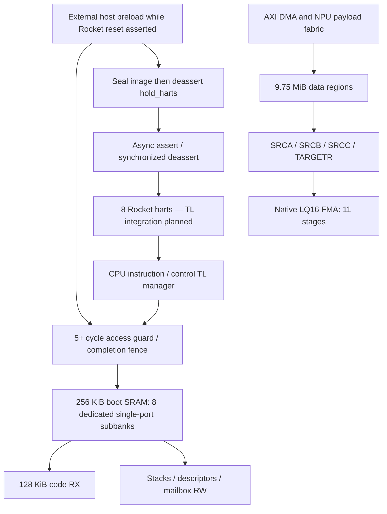

# S0/L0SRAM external preload and direct reset boot

S0SRAM in this boot contract means the reserved boot/control region of L0SRAM;
it is not another independently budgeted SRAM. L0SRAM reserves a physically separate boot/control region inside the total
10 MiB budget. This checkpoint implements the access guard, canonical parameter
propagation, linker layout, RV64 multi-hart firmware and a separate hart reset
controller. The external host preloads SRAM while harts are held in reset and
then releases them directly at the SRAM entry. **No boot ROM, CPU ROM loader or
ROM trampoline is part of the selected architecture. Actual Chipyard TL/external
preload bus integration and real Rocket RTL boot remain integration work.**



## Memory and permission contract

| Region | Default size | CPU address, upper bound exclusive |
|---|---:|---|
| All L0 | 10 MiB | `0x60000000..0x60a00000` |
| NPU data | 9.75 MiB | CPU payload access is not supplied by the boot guard |
| Boot code, RX | 128 KiB | `0x609c0000..0x609e0000` |
| Private stacks | 8 × 8 KiB | `0x609e0000..0x609f0000` |
| Control descriptors | 32 KiB | `0x609f0000..0x609f8000` |
| Mailbox | 4 KiB | `0x609f8000..0x609f9000` |
| Boot/control spare | 28 KiB | `0x609f9000..0x60a00000` |

A/B/C/meta remain 1/2/5/1 MiB; scratch shrinks to 768 KiB. There are now
156 logical banks and **392 single-port physical subbanks**. Each boot subbank is
256 bits × 1024 words = 32 KiB. One subbank serves a read OR write per issue cycle.
The boot reservation stays 256 KiB for default x1/x2/x4 profiles and bank-factor
sweeps; total L0 is 10/20/40 MiB and scratch absorbs the reservation. Code entries
are `0x609c0000`, `0x613c0000`, `0x627c0000` respectively.

Ingress wiring supplies trusted owner/hart identity; request payloads cannot
select privileged identities. Owner 0 is the trusted external preloader, owner 1
instruction fetch, owner 2 CPU/control data, owner 3 NPU tensor payload. After
commit, instruction fetch is read-only in CODE; CPU/control data can read boot
and write its RW portion; external preload ingress is locked. NPU payload cannot touch any
boot/control byte. A descriptor fetcher needing control memory must use the
trusted control ingress, never the tensor payload ingress. The guard checks the
whole burst, 1..4096 bytes, total bounds and hart number. Burst crossing fails
atomically before SRAM issue. Tags, owner, byte count and address survive stalls.

SRAM has no valid power-on contents. The boot sequence is:

1. Assert `fabric_reset` and `hold_harts`. The fabric/SRAM interface reset and
   Rocket execution reset are **different reset domains**. Keep SRAM powered and
   its interface clock running; release fabric_reset while holding Rocket reset.
2. The fabric observes all hart reset assertions through `BOOT_RESET_ACK_CYCLES`
   synchronizer stages. Only then may the external preload ingress accept writes.
   `tiny_npu_preloaded_boot` gates owner0 valid/ready with `preload_enable`.
3. External host writes code, zeroes/initializes RW data, verifies its image and
   drains all accepted writes through **physical SRAM completion**. Host-side
   verification qualifies `image_verified`; RW completion qualifies `rw_initialized`;
   `preload_idle` must cover the downstream write fabric, not just this metadata
   pipeline. A future external AXI/debug adapter must provide these semantics.
4. Host asserts commit_valid. The guard rejects incomplete qualification, blocks
   new ingress during commit and drains its metadata. Commit seals boot_ready;
   it does not itself require the external hold to be removed. Preload ingress is
   closed after sealing. A repeated commit reports an error.
5. Host deasserts `hold_harts`. Reset assertion is asynchronous; deassertion takes
   `L0_BOOT_HART_RELEASE_CDC_CYCLES` **hart-clock rising edges** after the request
   is stable. All harts receive `ROCKET_RESET_VECTOR=L0_BOOT_ENTRY_ADDR`. The first
   architectural fetch is SRAM, without fetching any ROM instruction. Firmware
   executes fence.i, initializes its private stack and publishes hart records.

A premature external release while boot_ready=0 leaves all harts in reset.
`tiny_npu_sram_boot_control` implements the reset synchronizers and static reset PC;
`tiny_npu_preloaded_boot` connects it to the guard. SRAM and the guard take
fabric_reset, never hart_reset. CPU-only reset reasserts hart reset without
clearing SRAM bytes, boot_ready or the code seal; reload is not necessary for
code retention. Restarting a whole application also requires an explicit mailbox/
semaphore epoch or RW reinitialization policy: the retention test does not prove
an application restart protocol. To replace code, re-enter fabric initialization
with every hart reset and caches invalidated; guard reset alone is insufficient.
Reset CDC synchronizers assume the hart clock runs during release. Metastability
MTBF, reset recovery/removal, power sequencing and physical placement need normal
implementation signoff; RTL cycle sweeps do not substitute for it.

The code block is instruction-cacheable RX; RW control storage should initially
be uncached to avoid missing CPU/DMA coherency. These attributes require TL/PMA
integration; they are not configured in the existing legacy Rocket config.

## Latency, bandwidth and credits

Parameters: `L0_BOOT_GUARD_CYCLES=5` (minimum five real stages; extra stages are
transport), `L0_BOOT_SRAM_READ_CYCLES=16`,
`L0_BOOT_TL_RETURN_CYCLES=2`, `L0_BOOT_HART_RELEASE_CDC_CYCLES=2`,
`L0_BOOT_TL_BEAT_BYTES=8`, `ROCKET_CACHE_BLOCK_BYTES=64`. None implies a one-cycle
read. All values travel through canonical JSON → SV/C/assembly/linker artifacts.

For an unloaded cache-line refill, measured from accepted guard ingress, use

`T_first = L_guard/f_guard + L_sram/f_sram + L_return/f_TL + T_queue + T_CDC`

`T_line = T_first + (ceil(line_bytes/TL_beat_bytes)-1) * II_TL/f_TL`.

Hart release additionally costs `L_release_CDC/f_hart`, plus up to one destination
clock period of phase uncertainty. Host preload and verification precede this.
Acknowledging held reset costs `L_ack/f_fabric` plus clock phase uncertainty.
No instruction executes during the preload interval. At equal 1 GHz **reference clocks only**, no queue or
additional crossing, 64 B line / 8 B beat / II=1 gives 23 ns first-beat and 30 ns
line completion; guard7/read32 gives 41/48 ns. These are planning bounds, not
measured Rocket miss latency. A cold 128 KiB code load at 10 GB/s requires at least
13.11 us of payload transfer, plus host-path startup, verification and zeroing if the external host transfers
from such a memory source. The previous700ns DRAM contract belongs to the NPU data
DMA and is not automatically an external preload transport guarantee.

For any pipelined manager, `N_outstanding >= ceil(request_rate * response_latency)`
and reserved response bytes must cover all accepted responses under consumer
stall. If outstanding units are complete 64 B lines at an 8 GB/s manager ceiling,
23 ns requires at least 3 lines / 192 B before queue/CDC margin. Fetch arbitration
must preserve bounded per-hart progress with eight harts; an initial single
outstanding manager will deliberately trade throughput for implementation size.
Bank raw capacity is `8 * 32 B * f_sram / II_subbank` shared read+write, subject to
conflicts. At the reference 1 GHz and II=1 this is 256 GB/s, while a single 64-bit
CPU return path is at most 8 GB/s. These ceilings do not establish CPU performance.
Boot banks cannot be counted toward MAC A/B/C traffic service capacity. Dedicated
boot guard latency does not add five cycles to the independent MAC data path.

The default FMA remains 11 arithmetic stages, feedback extra1, 12 accumulator
contexts, 32 register slots. The current serialized-vector planning estimate is
10.771972 useful TOPS at the historical 1 GHz model clock. **Sustained 10 TOPS in
integrated RTL and physical frequency are unverified.** Boot demand must eventually
be measured simultaneously with control and tensor traffic.

## Executed verification and reproduction

Source `tiny-npu/scripts/env.sh`, then from `tiny-npu/` run:

```
make generate-revb
make test-boot-firmware     # RISC-V GCC, objcopy and Spike, all three profiles
make test-boot-rtl          # uses x1 boot_words.hex generated above
make check-boot-depth      # Yosys or local YoWASP installation
make check-revb
```

* Spike, x1/x2/x4: **PASS**, all eight harts enter the L0-resident 192-byte RV64
  program, write and read private stacks, publish IDs and stack addresses, and
  hart0 validates all records before tohost PASS. Spike directly preloads the ELF;
  it does not prove Rocket caches, TL timing or hardware reset release. Spike has
  its own simulator reset stub; `--pc` establishes the tested SRAM entry. The
  selected hardware contract has no such ROM stub.
* Verilator guard+eight real single-port SRAM primitives: **PASS** at guard/read
  latencies **5/16 and 7/32**. Each case checks 8237 transactions, 8200 writes,
  25 reads, 11 denied operations and a blocked post-seal external preload, including external preload during hart reset, early-release inhibition,
  exact2/4-stage reset deassertion at1.4/4.2ns hart periods, CPU-only reset
  retention, initial data zeroing, code fetch by
  eight synthetic hart agents, stack byte writes, bounds, commit and backpressure.
  Synthetic agents do not execute instructions in this RTL fixture. The reset PC
  is connected to the tested first-fetch address assertion; it is not a wired
  Rocket frontend yet. CI separately uses a deterministic SRAM image without
  claiming compiled firmware execution (`--synthetic-image`).
* `check_boot_depth.py` synthesizes x1/x2/x4 with the same strict AND2/OR2/NOT and
  plain-DFF boundary convention as the FMA, fails above40, and runs randomized
  post-synthesis metadata/permission tests on the **exact audited netlist**.
  Measured maximum depths are **28/29/29 gates** for x1/x2/x4; each mapped
  netlist passed **1448** request comparisons. Native FMA netlists separately
  passed **2565/2555** exact-golden comparisons at latency11/13, including reset
  flush and backpressure ([results](fma_netlist_tests.json)).
  The complete flattened preload/reset wrapper is also audited at40 gates;
  [its results](preloaded_boot_gate_depth.json) include combinational paths into
  async reset pins. Only this reset-controller audit explicitly allows native
  positive-clock async-clear flops; the FMA audit still requires plain DFFs with
  all enable/synchronous-reset muxes decomposed.
  Machine-readable results: [gate depth](l0_boot_gate_depth.json),
  [RTL](l0_boot_rtl_tests.json), [ISA firmware](l0_boot_firmware_tests.json).
* RTL JSONL valid/ready traces, compressed VCD and interactive workload reports
  capture selected initialization transactions and the post-commit test window;
  they do not measure total loader throughput. They are in `build/l0-boot-rtl-g5-r16/` and `build/l0-boot-rtl-g7-r32/analysis/`.
  Spike logs and instruction-order traces are in `build/l0-boot-firmware-x*/`;
  instruction order is explicitly not a cycle-accurate performance trace.

A synthesis parser initially truncated a struct-array reply to one bit, while
Verilator preserved its SV meaning. The reply storage now uses an explicitly
sized packed vector, and synthesis includes `check -assert`. Post-synthesis
functional tests additionally protect against a misleading low gate-depth result
caused by erased datapaths. This is regression coverage, not formal equivalence.

## Ordered next integration work

1. Implement a TL manager around the guard and bank fabric, with correctly tagged
   SRAM responses, permission errors, narrow accesses, cache-line burst assembly,
   explicit credits and bounded eight-hart arbitration. Keep CPU boot and tensor
   data ingress separate. Test long/variable SRAM latency and consumer stalls.
2. Connect the parameterized eight-Rocket configuration to the SRAM reset-vector
   source and dedicated hart reset controller. Disable the BootROM source; enable
   the external reset-vector route. Add an external preload slave adapter and TL
   SRAM manager. Boot the same preloaded ELF in full Chipyard simulation and capture
   instruction misses, per-hart TL valid/ready, bank conflicts and boot elapsed
   cycles in the existing workload analyzer.
3. Integrate native FMA with operand/feedback/TC/OIC and full SRAM paths before
   array replication. Recheck each controller/memory stage against40 gates and
   issue II; use characterized SRAM macro timing separately from gate counts.
4. Run concurrent boot/control/DMA/MAC workloads with the specified700ns DRAM
   model; report useful sustained TOPS and required memory service. Change cache,
   frequency, banks, register slots, latency and MO only from canonical parameters.


## Chipyard integration boundary

The checked-out Rocket implementation initializes frontend PC from
`resetVectorSinkNode.bundle` (`rocket/Frontend.scala`), which must be driven by
this SRAM entry and stable before reset release. `HasTilesExternalResetVectorKey`
selects per-tile external reset-vector nodes in `subsystem/HasTiles.scala`.
Remove/disable `BootROMLocated` for the target configuration, since BootROM.attach
otherwise supplies its own vector (`devices/tilelink/BootROM.scala`). The TL SRAM
manager must be reachable for instruction fetch at the configured CPU window.
These are integration requirements, not a claim that the existing legacy4-core
Chipyard configuration has already been changed or elaborated. Software ELF entry,
reset-vector outputs, generated address map and canonical parameters agree now.
