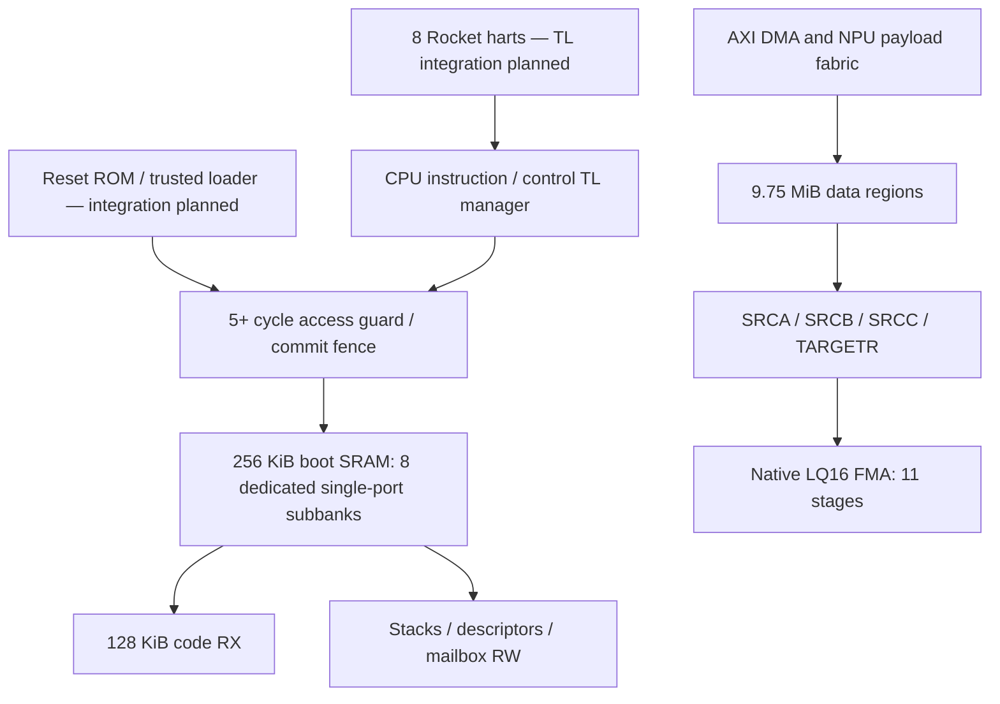

# L0SRAM boot support: design and verification checkpoint

L0SRAM now reserves a physically separate boot/control region inside the total
10 MiB budget. This checkpoint implements the access guard, canonical parameter
propagation, linker layout and RV64 multi-hart firmware. **A Chipyard TL manager,
reset-ROM loader and real Rocket RTL boot are still integration work.**



## Memory and permission contract

| Region | Default size | CPU address, upper bound exclusive |
|---|---:|---|
| All L0 | 10 MiB | `0x60000000..0x60a00000` |
| NPU data | 9.75 MiB | CPU payload access is not supplied by the boot guard |
| Boot code, RX | 128 KiB | `0x609c0000..0x609e0000` |
| Private stacks | 8 × 8 KiB | `0x609e0000..0x609f0000` |
| Control descriptors | 32 KiB | `0x609f0000..0x609f8000` |
| Mailbox | 4 KiB | `0x609f8000..0x609f9000` |
| Boot/control spare | 28 KiB | `0x609f9000..0x60a00000` |

A/B/C/meta remain 1/2/5/1 MiB; scratch shrinks to 768 KiB. There are now
156 logical banks and **392 single-port physical subbanks**. Each boot subbank is
256 bits × 1024 words = 32 KiB. One subbank serves a read OR write per issue cycle.
The boot reservation stays 256 KiB for default x1/x2/x4 profiles and bank-factor
sweeps; total L0 is 10/20/40 MiB and scratch absorbs the reservation. Code entries
are `0x609c0000`, `0x613c0000`, `0x627c0000` respectively.

Ingress wiring supplies trusted owner/hart identity; request payloads cannot
select privileged identities. Owner 0 is the trusted pre-commit loader, owner 1
instruction fetch, owner 2 CPU/control data, owner 3 NPU tensor payload. After
commit, instruction fetch is read-only in CODE; CPU/control data can read boot
and write its RW portion; loader writes are locked. NPU payload cannot touch any
boot/control byte. A descriptor fetcher needing control memory must use the
trusted control ingress, never the tensor payload ingress. The guard checks the
whole burst, 1..4096 bytes, total bounds and hart number. Burst crossing fails
atomically before SRAM issue. Tags, owner, byte count and address survive stalls.

SRAM has no valid power-on contents. The integration sequence must park all harts
in ROM/reset, load and verify code, initialize RW storage, drain all accepted
loader writes through **physical SRAM completion**, then commit. `loader_idle`,
`image_verified` and `rw_initialized` are integration inputs, not implemented
loader engines. Commit blocks new requests and waits for the guard pipeline to
drain. It raises boot_ready only once; a repeated commit reports an error. Hart
release crosses its explicit CDC; each hart executes fence.i before using L0 code.
Cold boot is supported by this contract. Resetting the guard alone does not revoke
cached instructions; warm code replacement needs a separate cache/reset protocol.
The code block is instruction-cacheable RX; RW control storage should initially
be uncached to avoid missing CPU/DMA coherency. These attributes require TL/PMA
integration; they are not configured in the existing legacy Rocket config.

## Latency, bandwidth and credits

Parameters: `L0_BOOT_GUARD_CYCLES=5` (minimum five real stages; extra stages are
transport), `L0_BOOT_SRAM_READ_CYCLES=16`,
`L0_BOOT_TL_RETURN_CYCLES=2`, `L0_BOOT_HART_RELEASE_CDC_CYCLES=2`,
`L0_BOOT_TL_BEAT_BYTES=8`, `ROCKET_CACHE_BLOCK_BYTES=64`. None implies a one-cycle
read. All values travel through canonical JSON → SV/C/assembly/linker artifacts.

For an unloaded cache-line refill, measured from accepted guard ingress, use

`T_first = L_guard/f_guard + L_sram/f_sram + L_return/f_TL + T_queue + T_CDC`

`T_line = T_first + (ceil(line_bytes/TL_beat_bytes)-1) * II_TL/f_TL`.

Hart release additionally costs `L_release_CDC/f_hart`; reset-ROM loading and
verification are separate. At equal 1 GHz **reference clocks only**, no queue or
additional crossing, 64 B line / 8 B beat / II=1 gives 23 ns first-beat and 30 ns
line completion; guard7/read32 gives 41/48 ns. These are planning bounds, not
measured Rocket miss latency. A cold 128 KiB code load at 10 GB/s requires at least
13.11 us of payload transfer, plus DRAM startup, verification and zeroing.

For any pipelined manager, `N_outstanding >= ceil(request_rate * response_latency)`
and reserved response bytes must cover all accepted responses under consumer
stall. If outstanding units are complete 64 B lines at an 8 GB/s manager ceiling,
23 ns requires at least 3 lines / 192 B before queue/CDC margin. Fetch arbitration
must preserve bounded per-hart progress with eight harts; an initial single
outstanding manager will deliberately trade throughput for implementation size.
Bank raw capacity is `8 * 32 B * f_sram / II_subbank` shared read+write, subject to
conflicts. At the reference 1 GHz and II=1 this is 256 GB/s, while a single 64-bit
CPU return path is at most 8 GB/s. These ceilings do not establish CPU performance.
Boot banks cannot be counted toward MAC A/B/C traffic service capacity. Dedicated
boot guard latency does not add five cycles to the independent MAC data path.

The default FMA remains 11 arithmetic stages, feedback extra1, 12 accumulator
contexts, 32 register slots. The current serialized-vector planning estimate is
10.771972 useful TOPS at the historical 1 GHz model clock. **Sustained 10 TOPS in
integrated RTL and physical frequency are unverified.** Boot demand must eventually
be measured simultaneously with control and tensor traffic.

## Executed verification and reproduction

Source `tiny-npu/scripts/env.sh`, then from `tiny-npu/` run:

```
make generate-revb
make test-boot-firmware     # RISC-V GCC, objcopy and Spike, all three profiles
make test-boot-rtl          # uses x1 boot_words.hex generated above
make check-boot-depth      # Yosys or local YoWASP installation
make check-revb
```

* Spike, x1/x2/x4: **PASS**, all eight harts enter the L0-resident 192-byte RV64
  program, write and read private stacks, publish IDs and stack addresses, and
  hart0 validates all records before tohost PASS. Spike directly preloads the ELF;
  it does not prove ROM copying, Rocket caches, TL timing or hardware reset release.
* Verilator guard+eight real single-port SRAM primitives: **PASS** at guard/read
  latencies **5/16 and 7/32**. Each case checks 8237 transactions, 8200 writes,
  24 reads, 12 denied operations, including initial data zeroing, code fetch by
  eight synthetic hart agents, stack byte writes, bounds, commit and backpressure.
  Synthetic agents do not execute instructions in this RTL fixture.
* `check_boot_depth.py` synthesizes x1/x2/x4 with the same strict AND2/OR2/NOT and
  plain-DFF boundary convention as the FMA, fails above40, and runs randomized
  post-synthesis metadata/permission tests on the **exact audited netlist**.
  Measured maximum depths are **28/29/29 gates** for x1/x2/x4; each mapped
  netlist passed **1448** request comparisons. Native FMA netlists separately
  passed **2565/2555** exact-golden comparisons at latency11/13, including reset
  flush and backpressure ([results](fma_netlist_tests.json)).
  Machine-readable results: [gate depth](l0_boot_gate_depth.json),
  [RTL](l0_boot_rtl_tests.json), [ISA firmware](l0_boot_firmware_tests.json).
* RTL JSONL valid/ready traces, compressed VCD and interactive workload reports
  capture selected initialization transactions and the post-commit test window;
  they do not measure total loader throughput. They are in `build/l0-boot-rtl-g5-r16/` and `build/l0-boot-rtl-g7-r32/analysis/`.
  Spike logs and instruction-order traces are in `build/l0-boot-firmware-x*/`;
  instruction order is explicitly not a cycle-accurate performance trace.

A synthesis parser initially truncated a struct-array reply to one bit, while
Verilator preserved its SV meaning. The reply storage now uses an explicitly
sized packed vector, and synthesis includes `check -assert`. Post-synthesis
functional tests additionally protect against a misleading low gate-depth result
caused by erased datapaths. This is regression coverage, not formal equivalence.

## Ordered next integration work

1. Implement a TL manager around the guard and bank fabric, with correctly tagged
   SRAM responses, permission errors, narrow accesses, cache-line burst assembly,
   explicit credits and bounded eight-hart arbitration. Keep CPU boot and tensor
   data ingress separate. Test long/variable SRAM latency and consumer stalls.
2. Connect the parameterized eight-Rocket configuration, ROM loader and hart
   parking/release. Boot the same ELF in full Chipyard simulation and capture
   instruction misses, per-hart TL valid/ready, bank conflicts and boot elapsed
   cycles in the existing workload analyzer.
3. Integrate native FMA with operand/feedback/TC/OIC and full SRAM paths before
   array replication. Recheck each controller/memory stage against40 gates and
   issue II; use characterized SRAM macro timing separately from gate counts.
4. Run concurrent boot/control/DMA/MAC workloads with the specified700ns DRAM
   model; report useful sustained TOPS and required memory service. Change cache,
   frequency, banks, register slots, latency and MO only from canonical parameters.
