> 이전 설계/구현 기록입니다. 최신 8-core·10 MiB single-port·LQ16/TF32 구조와 가변 경로 latency 계약은 [RevB HDD](../architecture/v2/HDD.md)를 참조하세요.

# TINY NPU Data Pipelining 설계 규약

상태: P0 지속10 useful TOPS를 위한 설계 요구사항. 현재 R1 dual-result-buffer와 R2 4단계 FP32 가산·C SRAM slice·scoreboard는 구현됐다. 전체 SRAM banking·AXI DMA·scale converter 물리 pipeline은 후속 구현 대상이다.

## 1. 중첩 실행 구조

```mermaid
flowchart LR
    DMA[AXI DMA prefetch] --> RX[RX FIFO / reorder / credit]
    RX --> AB[A/B ping-pong SRAM]
    AB --> RD[SRAM read / vector align]
    RD --> DEC[FP4 decode]
    DEC --> MUL[Product pipeline]
    MUL --> MAC[PE accumulate K=32]
    MAC --> SNAP[Dual result snapshots]
    SNAP --> SCALE[Scale / FP32 conversion]
    SCALE --> EF[Elastic FIFO]
    EF --> ADD[FP32 add + C scoreboard]
    ADD --> C[C SRAM writeback]
    C --> TX[TX FIFO / AXI store]
```

- DMA는 panel n+1을 준비하는 동안 compute는 panel n을 처리한다.
- MAC은 tile n+1을 계산하는 동안 snapshot n을 후단으로 배출한다.
- 후단은 group별 scale을 적용한 뒤 해당 C tile의 FP32 값에 누산한다.
- 결과 DMA는 완료된 C tile만 읽는다. 다음 compute와 중첩하려면 다른 C bank/context 또는 확실한 중재가 필요하다.
- 현재 이벤트 모델은 입력 prefetch/compute 중첩을 반영하지만 macro 출력 DMA와 다음 macro 계산의 중첩은 가정하지 않는다. 따라서 이 최적화 없이도 기준 모델의 목표 통과를 확인한다.

## 2. 기본 stage 요구사항

| Stage | 목표 latency | 목표 initiation interval / 처리량 | 구현 상태 |
|---|---:|---|---|
| SRAM read | 2 cycles | 매 cycle 벡터 공급 | R3 예정; 현재 template read는1cycle |
| FP4 decode | 1 cycle | 모든 활성 PE 입력/clock | R1은 조합 decode; 물리 pipeline 예정 |
| Product | 1 cycle | 10240 products/clock | R1 기능 구현; 물리 pipeline 예정 |
| PE accumulate | feedback1cycle | 매 PE 1MAC/clock, K=32 | R1 구현 |
| Snapshot drain | 32 transfers/group | 320 int32/clock | R1 이중 버퍼 구현 |
| Scale/FP32 conversion | 4 cycles | 320 results/clock | R1은 조합 converter; pipeline 예정 |
| FP32 add | 4 cycles | 320 results/clock | R2 구현: 무stall latency4/II1 검증 |
| C writeback | 2 cycles | 1280B/clock | R3 예정 |

Latency와 처리 간격을 구분한다. 4-stage FP32 add도 II=1이면 매 cycle 새 데이터를 받을 수 있다. C 동일 주소의 feedback recurrence는 SRAM read2+adder4+write2=8cycles 이상을 확보하거나 forwarding해야 한다.

## 3. 기본 버퍼·credit 파라미터

| Parameter | Default | ×2 / ×4 | 의미 |
|---|---:|---|---|
| DATA_PIPELINING_REQUIRED | true | true | P0 필수 |
| OPERAND_BUFFER_SLOTS | 2 | 2 / 2 | ping-pong input panel |
| RESULT_BUFFER_SLOTS | 2 | 2 / 2 | 현재 R1 snapshot slot 수 |
| FP32_INTERLEAVE_CONTEXTS | 8 | 8 / 8 | lane별 독립 C 주소 문맥; recurrence gap 확보 |
| FP32_ELASTIC_FIFO_BYTES | 16384 | 32768 / 65536 | scale/adder 사이 예약 공간 |
| DMA_READ_BUFFER_BYTES | 131072 | 262144 / 524288 | RX/reorder 버퍼 예산 |
| DMA_WRITE_BUFFER_BYTES | 65536 | 131072 / 262144 | TX 버퍼 예산 |
| DMA_CREDIT_CONTROL_REQUIRED | true | true | byte·slot·ID 자원 예약 후 issue |
| PANEL_PIPELINE_OVERHEAD_CYCLES | 14 | 14 / 14 | 모델에서 각 K-panel에 보수적으로 더하는 지연 |

기본 후단은320×4=1280B/clock이다. Scale4+add4=8cycles의 in-flight payload는10240B이므로16KiB elastic 예산을 확보한다. 실제 ready 전파 지연·CDC·alignment queue가 더 크면 FIFO도 늘린다. 이 FIFO는 SRAM 예산의 partial/meta 영역에 포함해 주소를 예약하며 공짜 메모리로 추가하지 않는다.

14cycle의 모델 항목은 read2+decode1+product1+scale4+add4+write2이다. PE feedback1cycle은 기존32개의 MAC 실행 cycle에 포함해 중복 가산하지 않는다. 실제 stage overlap은 cycle-accurate RTL에서 더 정확히 검증해야 한다.

## 4. Hazard 및 backpressure

1. Operand slot은 DMA가 소유권을 확보한 뒤 쓰고, 모든 소비가 끝나야 반환한다. 같은 주소 overwrite 금지.
2. 모든 stage가 valid/ready 또는 동등한 credit 규약을 사용한다. Stall 중 payload와 tile/job/K/row/column/scale 태그를 유지한다.
3. C scoreboard로 같은 주소의 read-modify-write 중복 발행을 막는다. 8-context interleave는 작은 workload에서 항상 가능하지 않으므로 forwarding 또는 stall fallback을 반드시 구현한다.
4. DMA read issue는 MO만 보지 않는다. `issue_bytes <= free_RX + reserved_destination_SRAM`이고, reorder entry·source ID도 먼저 예약한다. 기본64MO×4096B=256KiB는 RX128KiB보다 크므로 모든 요청을 무조건 발행하면 안 된다.
5. AXI R/B reorder와 tile 순서를 분리한다. AXI4 W channel은 AW 순서와 맞추며 WID를 가정하지 않는다.
6. C 누산과 결과 DMA가 동일 bank/주소를 경쟁하면 schedule하거나 전용 window를 둔다. 단순 FIFO만으로 bank BW 부족을 해결할 수 없다.
7. Ready의 긴 조합 경로는 skid/elastic buffer로 끊는다. 경로별 credit·ID·slot 의존성을 검토해 순환 대기와 deadlock을 방지한다.
8. Job 완료는 마지막 계산이 아니라 마지막 결과 write-response 이후이다. Reset/abort는 pipeline epoch와 in-flight memory transaction을 함께 처리한다.

## 5. 검증과 성능 계측

- 단일 token/연속 stream/random stall/full FIFO/동일 C 주소 hazard를 각각 검사한다.
- 태그 보존, 데이터 유실·중복 없음, slot 반환, queue occupancy 상한을 assertion으로 검증한다.
- Array input stall, snapshot full, scale FIFO full, FP32 dependency, C bank conflict, DMA credit 부족을 별도 카운트한다.
- 기준1024×1024×4096 전체 실행에14cycle/panel 지연을 반영한 모델 결과는 약13.4775TOPS/637.355µs이다. P0한도858.9934592µs 아래지만 실증은 아직 아니다.
- SRAM·FP32·AXI stage가 모두 연결된 R5에서 실제 useful TOPS≥10과 결과 정확도를 동시에 확인한다.

## R2 구현과 목표의 차이

실제R2는4단계FP32adder와1-cycle C SRAM slice,32개row scoreboard를사용한다. C RAM은lane별32bit×32word이며목표8MiB256-bitbanking과는다르다. DMA byte-credit/ID와4KiBplanner는전단unit만있고AXI master는없다. Scale converter는현재조합회로이다. 전체파이프라인을연결했다거나지속10TOPS를검증했다고해석하지않는다.
