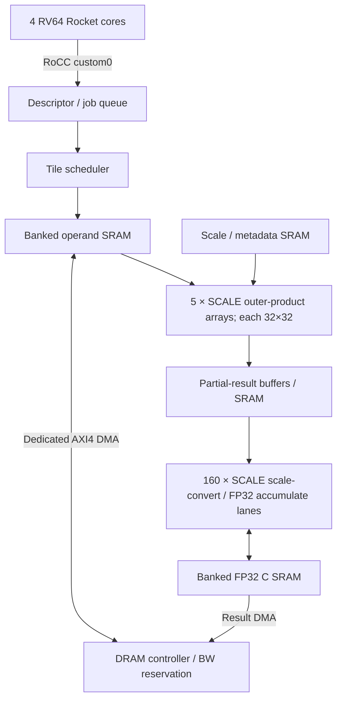

> 이전 설계/구현 기록입니다. 최신 8-core·10 MiB single-port·LQ16/TF32 구조와 가변 경로 latency 계약은 [RevB HDD](../architecture/v2/HDD.md)를 참조하세요.

> ARCHIVED: P0가 지속10TOPS로 변경되기 전의 피크10.24TOPS 사양입니다. 최신 문서는 TINY_NPU_HDD_AND_ROADMAP.md입니다.

# MXFP4 × MXINT8 Matmul Accelerator — Hardware Design Document

문서 상태: 설계 제안 및 실행 가능한 성능 모델. Matmul RTL/ASIC 합성/DRAM 실측 검증은 아직 수행하지 않았다.

이 문서와 `spec_model.py`가 최신 기준이다. 이전 `latency-report.md`의 “10 GB/s raw × 60% = 6 GB/s” 가정은 요구사항 정정으로 폐기한다.

## 1. 요구사항과 범위

- 기본 시스템 전체 연산 피크: 10 TOPS 이상, 1 MAC=2 operations.
- 기본 로컬 SRAM: 2 MiB. 기본 유효 외부 대역폭: 읽기+쓰기 합계 10 decimal GB/s 이상을 목표로 설계.
- 메모리 효율 60%를 적용한 이후에도 위 payload 대역폭을 달성할 수 있어야 한다.
- Read 요청에서 첫 데이터까지 700 ns. Write B 응답 지연은 별도 명세가 없으므로 마지막 W 데이터 이후 700 ns로 모델링한다.
- 4 RV64 Rocket, 각 L1I/L1D 8 KiB, 공유 L2 64 KiB는 호스트 실행용. Matmul A/B/scale/C는 이 캐시들을 경유하지 않는다.
- RoCC는 제어 전용, 행렬 데이터는 전용 AXI DMA ↔ 로컬 SRAM ↔ MAC 경로를 사용한다.
- SCALE={1,2,4}로 생성 파라미터를 확장한다. 이는 목표 RTL generator의 계약이며, 현재 실행 가능한 것은 성능 모델이다.

## 2. 프로파일

| 항목 | Default ×1 | ×2 | ×4 |
|---|---:|---:|---:|
| SCALE | 1 | 2 | 4 |
| MAC arrays, 각 32×32 | 5 | 10 | 20 |
| MAC/clock | 5,120 | 10,240 | 20,480 |
| 연산 클록 | 1 GHz | 1 GHz | 1 GHz |
| 피크 TOPS | 10.24 | 20.48 | 40.96 |
| 평균 K=32 타일 간격 | 6.4 clocks | 3.2 clocks | 1.6 clocks |
| FP32 후단 lanes | 160 | 320 | 640 |
| SRAM | 2 MiB | 4 MiB | 8 MiB |
| 유효 외부 BW 목표, R+W 합계 | 10 GB/s | 20 GB/s | 40 GB/s |
| 최소 raw BW @60% | 16.667 GB/s | 33.333 GB/s | 66.667 GB/s |
| AXI data width | 256 bits | 512 bits | 1024 bits |
| AXI clock | 625 MHz | 625 MHz | 625 MHz |
| 제공 raw BW, 한 방향 | 20 GB/s | 40 GB/s | 80 GB/s |
| 60% 적용 후 가용 payload 용량 | 12 GB/s | 24 GB/s | 48 GB/s |
| 목표 대비 가용 BW 여유 | 20% | 20% | 20% |
| Read / Write MO | 32 / 16 | 64 / 32 | 128 / 64 |
| AXI ID bits | 6 | 7 | 8 |
| 최대 DMA burst bytes | 2048 | 4096 | 4096 |
| 최대 C macro tile | 608×320 | 864×448 | 1216×640 |

1024-bit AXI는 설계 후보이다. 실제 SoC bridge/controller가 해당 폭·클록을 지원해야 한다. 지원하지 않으면 병렬 포트 구성 등 플랫폼 통합 변경이 필요하며, 단순 파라미터 변경만으로 물리 인터페이스 능력이 생기는 것은 아니다.

## 3. 구조와 제어



각 PE는 C[i,j] 하나의 K=32 정수 부분합을 계산한다. 매 clock A 열 32개와 B 행 32개를 broadcast하여 배열당 1024 MAC을 수행한다. 이는 zero-skew outer-product 구성의 목표이며, 일반 systolic array의 fill/drain 시간을 무시한 수치로 혼동하지 않는다. Broadcast 배선은 지역 파이프라인·분할 배치를 적용하고 합성으로 검증한다.

32-cycle K 누산이 끝나면 결과 보관 버퍼로 넘겨 다음 블록을 시작한다. 2개 결과 버퍼/array와 동시 drain을 전제로 한다. 최종 결과 latency에는 입력 전송·파이프라인·스케일 처리·결과 저장이 추가된다.

RoCC funct: CONFIG=0, SUBMIT=1, STATUS=2, WAIT=3. rs1/rs2는 descriptor 또는 제어 값이며 행렬 payload가 아니다. 기본 hart0 단독 제출, 비동기 job-ID 반환, polling 완료. 실제 matmul은 기존 accumulator 예제와 동일 opcode를 동시에 소유하지 않는다.

## 4. 수치와 데이터 레이아웃

| Parameter | Default | 허용값 / 설명 |
|---|---|---|
| A_FORMAT | MXFP4_E2M1 | FP4×32 + E8M0 scale 1개 |
| B_FORMAT | OCP_MXINT8 | 정확한 fixed-point·scale 해석을 golden model과 일치시킴 |
| SCALE_FORMAT / BLOCK_K | E8M0 / 32 | A 행·B 열 각각 K축 그룹 |
| A_LAYOUT | ROW_K_BLOCKED | 같은 행의 K=32 그룹을 연속 저장 |
| B_LAYOUT | COLUMN_K_BLOCKED | 같은 열의 K=32 그룹을 연속 저장 |
| NIBBLE_ORDER | LOW_FIRST | 소프트웨어 packing과 동일 |
| PARTIAL_BITS | 32 | K=32 내부 정수 누산 |
| ACC_FORMAT | FP32 | 그룹별 scale 적용 후 K 오름차순 누산 |
| OUTPUT_FORMAT | FP32 | BF16은 선택 기능, 본 성능표는 FP32 |
| ROUND / SUBNORMAL | RNE / GRADUAL | FTZ 선택은 별도 수치 모드 |
| OVERFLOW / INVALID_SCALE | IEEE_INF / PROPAGATE_NAN | 확정 명세와 bit-exact 모델 필요 |
| TAIL_POLICY | MASK_ZERO_PAD | 현 성능 모델은 M/N/K가 32의 배수인 경우만 실행 |
| C_INIT | ZERO | 기존 C 읽기 없는 C=A×B. 누산 모드는 추가 DRAM traffic 필요 |

E2M1 유한 값을 2배하여 작은 signed 정수로 표현하고 INT8과 곱한다. OCP MXINT8 fixed-point 보정과 두 E8M0 scale을 K=32 그룹별로 적용한다. 서로 다른 그룹의 scale을 적용하기 전에 부분합을 합치지 않는다.

외부 packed 데이터 크기:

```
A bytes = M*K*(1/2 + 1/32) = 17*M*K/32
B bytes = N*K*(1   + 1/32) = 33*N*K/32
C bytes = 4*M*N
operations = 2*M*N*K
```

Padding, descriptor, AXI efficiency overhead는 payload 수식과 구분한다. 행렬 packing 시간은 모델에서 제외한다. 모델은 A/B 및 두 scale stream의 시작 주소가 각각 4 KiB 정렬된 것으로 가정한다.

## 5. SRAM 구성

각 region 용량과 bank 수를 SCALE에 비례하여 증가시키고 폭·깊이는 유지한다. 1R1W, 1 GHz, byte write mask, 기본 read latency 2 cycles를 목표로 한다.

| Region | 기본 용량 | Banks ×1/×2/×4 | 폭 | 깊이/bank | ×1 최대 R / W |
|---|---:|---|---:|---:|---:|
| Operand | 1024 KiB | 16 / 32 / 64 | 256 bit | 2048 | 512 / 512 GB/s |
| FP32 C | 768 KiB | 24 / 48 / 96 | 256 bit | 1024 | 768 / 768 GB/s |
| Partial | 128 KiB | 32 / 64 / 128 | 256 bit | 128 | 1024 / 1024 GB/s |
| Scale/meta | 128 KiB | 8 / 16 / 32 | 128 bit | 1024 | 128 / 128 GB/s |
| Total | 2048 KiB | 80 / 160 / 320 | — | — | 2432 / 2432 GB/s |

위 operand 배분은 A 256 KiB, B 512 KiB, staging 256 KiB를 SCALE에 비례 확장한다. 모든 DMA FIFO/작업 저장소는 해당 region 용량 안에서 예산을 확보한다. CDC FIFO·PE 레지스터 등 비-SRAM 저장소는 별도 register/physical area 항목으로 집계한다. Shallow partial bank의 SRAM 매크로 효율이 낮으면 register-file/분산 버퍼 구현을 비교한다.

ECC 기본 OFF; SECDED 선택 시 물리 비트·면적을 별도 증가시킨다. SRAM 물리 포트 총합은 DRAM 대역폭이나 단일 실효 경로의 대역폭이 아니다.

## 6. 내부 Data Movement

아래는 서로 다른 타일을 처리하고 모든 정수 부분합을 partial SRAM에 기록/읽기 하는 보수적 기본 경로이다.

| 경로 | ×1 | ×2 | ×4 |
|---|---:|---:|---:|
| A operand reads | 80 GB/s | 160 GB/s | 320 GB/s |
| B operand reads | 160 GB/s | 320 GB/s | 640 GB/s |
| Scale reads, 평균 | 10 GB/s | 20 GB/s | 40 GB/s |
| Partial writes | 640 GB/s | 1280 GB/s | 2560 GB/s |
| Partial reads | 640 GB/s | 1280 GB/s | 2560 GB/s |
| C FP32 reads | 640 GB/s | 1280 GB/s | 2560 GB/s |
| C FP32 writes | 640 GB/s | 1280 GB/s | 2560 GB/s |
| 유용 내부 payload 합계 | 2810 GB/s | 5620 GB/s | 11240 GB/s |

C 초기 zero 블록의 read 생략과 부분합 직접 bypass는 후속 최적화이다. 기본 처리량은 이 최적화 없이 성립하도록 한다. Bank별 주소 분산, C read-modify-write forwarding, 동일 주소 hazard 방지, compute/DMA 중재가 필요하다. 계산 피크에 필요한 비율로 후단을 확장하지 않으면 배열 수만 늘려도 TOPS가 늘지 않는다.

## 7. AXI·DMA·MO

대역폭 의미를 구분한다:

```
raw_GBs = AXI_DATA_BITS/8 * AXI_CLOCK_HZ / 1e9
available_payload_GBs = raw_GBs * 0.60
available_payload_GBs >= target_GBs
```

기본 raw20 → 가용12 GB/s이고 성능 모델은 보장 목표인 10 GB/s만 사용한다. DRAM controller의 지속 대역폭·read/write turnaround·CPU 중재 이후에도 목표를 만족하도록 reservation을 설정해야 한다. 효율 60%에는 지속 payload의 프로토콜/메모리 손실을 묶어 반영하며, 모델은 700ns 초기 latency와 MO 제약을 별도로 추가한다. 이미 latency 부족까지 포함해 측정된 60%를 넣으면 이중 계산이 될 수 있으므로 실측 시 정의를 맞춘다.

### 7.1 MO 산정

ID를 마지막 데이터 beat까지 점유하고 700 ns가 첫 데이터 전 지연일 때:

```
BDP_bytes = target_bytes_per_second * 700 ns
min_MO_full_burst = ceil(1 + BDP_bytes / burst_bytes)
```

| Profile | BDP | Burst | Full-burst 최소 read MO | 설계 read / write MO |
|---|---:|---:|---:|---:|
| ×1 | 7000 B | 2048 B | 5 | 32 / 16 |
| ×2 | 14000 B | 4096 B | 5 | 64 / 32 |
| ×4 | 28000 B | 4096 B | 8 | 128 / 64 |

작은 scale 요청, ID fragmentation, bank conflict 때문에 최소값은 실제 작업의 충분조건이 아니다. 기본 matmul MO sweep은 아래 실행 결과를 참고한다. 64-byte 요청만 사용하면 ×1에서도 최소 약111개가 필요하므로, 데이터와 scale을 burst로 모아 전송한다.

### 7.2 버스 계약과 기본 파라미터

| Parameter | Default / 규칙 | Enum·제약 |
|---|---|---|
| AXI_PROTOCOL | AXI4 | INCR burst만 발행 |
| AXI_ADDR_BITS | 40 | {32,40,48}, 실제 SoC 물리 주소와 동일 |
| AXI_DATA_BITS | 256*SCALE | {256,512,1024} |
| AXI_ID_BITS | 6+log2(SCALE) | ID namespace 또는 bridge source 추적 검증 |
| AXI_STRB_BITS | DATA_BITS/8 | byte write enable |
| AXI_LEN_BITS / SIZE_BITS | 8 / 3 | beats−1 / log2(bytes per beat) |
| AXI_MAX_BURST_BEATS | 64 | {16,32,64,128,256}; 4 KiB 경계 우선 |
| DMA_MAX_BURST_BYTES | min(64*beat_bytes,4096) | 2048/4096/4096 |
| DMA_READ_MO / WRITE_MO | 32*S / 16*S | 모든 bridge·FIFO·ID 테이블 동일 상한 지원 |
| DMA_READ/WRITE_CHANNELS | 2 / 1 | A/B 독립 스케줄, 외부 포트는 하나 |
| DMA_RX/TX_BUFFER_BYTES | 64KiB*S / 32KiB*S | 로컬 SRAM 예산 안에 포함 |
| DMA_ADDRESS_MODE | PHYSICAL | IOMMU는 후속 선택 기능 |
| DMA_COHERENCE | NONCOHERENT | CPU cache/L2 snoop에 의존하지 않음 |
| DMA_SCALE_FETCH | SEPARATE_STREAM | scale 주소 정렬·연속 전송 |
| DMA_2D_STRIDE | ON | 행렬 블록 전송 |
| DMA_UNALIGNED / NARROW | OFF / OFF | 데이터 버퍼 beat 정렬, tail은 full read/WSTRB 처리 정책 필요 |
| DMA_SG | OFF | 초기 scatter-gather 미지원 |
| AXI_ARCACHE/AWCACHE | 0010 제안 | normal noncacheable/nonbufferable, 플랫폼 정책 확인 |
| AXI_ARPROT/AWPROT | 000 제안 | privileged/secure/data, SoC 보안 정책에 맞춤 |
| AXI_QOS | programmable | 0..15; 예약 BW를 구현하는 중재 설정과 연결 |
| AXI_REGION | 0 | 플랫폼이 요구하지 않으면 생략/0 |
| AXI_USER | 0-bit | 플랫폼 필요 시 채널별 정의 |
| AXI_LOCK / ATOMIC | OFF / OFF | exclusive/atomic 미발행 |
| AXI_ENDIANNESS | LITTLE | host와 packing 동일 |
| WRITE_INTERLEAVE | OFF | AXI4 WID 없음; AW/W 순서 보존 |
| DMA_ERROR_POLICY | ABORT_JOB | RRESP/BRESP 오류, fault address·job ID 보존 |
| DMA_RETRY | OFF | write 부작용 방지 |
| DMA_TIMEOUT | programmable, default OFF | 정상 backpressure와 구분 |
| CDC_MODE | ASYNC_FIFO | 1GHz ↔ 625MHz |
| CDC_AR/AW/B_DEPTH | 8*S / 8*S / 8*S | 포인터 동기화 2 stages 기본 |
| CDC_R/W_DEPTH | 32*S / 32*S beats | beat 폭 증가의 저장 비트 비용도 집계 |
| RESET | active-low, sync release | in-flight drain 후 local reset |

전용 AXI master port의 실제 interconnect·DRAM controller 연결은 별도 SoC 통합 작업이다. 일반 RoCC wrapper가 자동으로 이 포트를 제공하지 않는다. 내부 TL bridge를 사용한다면 데이터 폭/source-ID/MO를 함께 확장하되 CPU 캐시 경로를 우회해야 한다.

## 8. DMA ownership와 실행 순서

1. CPU/producer가 uncached DMA buffer에 packed A/B와 scales, descriptor를 준비한다. Cacheable alias는 금지한다.
2. 필요한 fence 후 RoCC SUBMIT, descriptor 유효성을 검사한다.
3. DMA가 두 operand slot에 K=32 panel을 prefetch한다.
4. SRAM에서 A/B를 반복 사용하며 모든 M/N microtile을 처리한다. L1/L2 접근 없음.
5. 각 K 그룹에 scale을 적용해 C SRAM에 FP32 누산한다.
6. 마지막 K 완료 후 C를 DMA 저장한다.
7. 모든 write response를 받은 뒤 job 완료를 게시한다. CPU는 동기화 후 결과 접근한다.

실행 중 CPU의 입력 수정/결과 읽기는 금지한다. Fence만으로 cache writeback이 된다고 가정하지 않는다.

## 9. Roofline·성능 모델

```
AI = operations / external_payload_bytes
roofline = min(peak_TOPS, AI * guaranteed_payload_BW)
time_lower_bound = max(compute_time, payload_time)
```

실제 모델은 burst별 issue/first-data latency, read/write MO, ID 반환, 4 KiB 분할, 공유 R+W payload bus, 두 operand slot을 이벤트로 계산한다. 한 panel의 입력이 전부 도착하면 계산을 시작한다. C macro 전체를 SRAM에 유지하고 마지막에 저장한다. Macro 사이 입력 재사용/전송 중첩은 하지 않는다.

별도 입력마다 read first-data latency 700ns, write 마지막 beat 뒤 B tail 700ns를 가정한다. 요청 발행 간격은 방향별 1ns. 실제 DDR bank/row 스케줄링, refresh 변동, packing/CPU/RoCC 비용, SRAM conflict 및 파이프라인 fill/drain은 모델에 없다. 결과는 물리 검증값이 아니다.

단일 32×32×32 타일은 A544 B1056 C4096 =5696 B를 이동한다. 기본 평균6.4ns 타일 처리 간격에 맞춰 매번 DRAM 공급하려면 890 GB/s가 필요하므로, 독립 타일 workload는 10GB/s에서 compute peak를 활용할 수 없다.

기본 피크를 10GB/s에서 유지하려면 AI>=1024 ops/B가 필요하다. 현재 C-resident schedule에서 768KiB FP32 C의 연속 shape 최적화 상한은 약599.1 ops/B, 즉 K가 매우 커도 약5.99TOPS이다. 이 상한은 해당 schedule 및 cross-macro 재사용 없음 조건에 한정된다. ×2/×4의 더 큰 C SRAM은 이 reuse 제약도 완화한다.

## 10. 파라미터만으로 ×2·×4 확장하는 절차

```bash
cd /workspace/analysis/mxfp4-matmul
python3 spec_model.py --scale 1
python3 spec_model.py --scale 2
python3 spec_model.py --scale 4
# 모든 profile과 비교 결과 재생성
python3 spec_model.py
```

모델에서 SCALE 한 값만 변경하면 arrays, lanes, SRAM banks/capacity, AXI width/ID, DMA MO/buffers, CDC depths, macro tile이 함께 파생된다. `profiles.json`에 생성된 모든 값을 확인할 수 있다.

RTL 구현에서는 이 JSON과 동일한 단일 parameter case class를 만들고 연결 폭/배열 수를 파생시켜야 한다. 현재 matmul RTL generator는 없으므로 “이미 RTL도 parameter-only 확장 검증됨”으로 해석하면 안 된다. 물리 SRAM 매크로 조합, AXI width 지원, DRAM BW, 1GHz 타이밍, 면적·전력·배선은 profile마다 다시 검증한다.

Compute-only 증설(SRAM/DMA 고정)은 별도 탐색 모드로 취급하며 sustained 성능의 ×2/×4를 보장하지 않는다. 같은 작은 문제의 실행시간은 700ns 고정 latency 때문에 선형 축소되지 않는다.

## 11. 검증·수용 기준

- 수치: MX encode/decode, sign/zero/최대값/invalid scale, K 그룹별 scale, FP32 rounding, tail, bit-exact golden model.
- 기능: 32×32 한 tile → 다중 tile → K 누산 → 5/10/20 배열 동시 실행.
- Data movement: DMA 4KiB split, 작은 scale 요청, bank conflict, ping-pong overwrite, backpressure, out-of-order 응답, R/B 오류·reset.
- Bus: 실제 60% 효율 조건의 장시간 read/write 및 mixed 전송에서 aggregate 목표10/20/40GB/s. QoS로 CPU 경쟁 후에도 목표 확인. 유한 전송 startup 오차는 제외해 steady state와 별도 보고.
- Compute: 데이터 SRAM 상주 시 5120/10240/20480 MAC/cycle; 후단160/320/640 results/cycle의 initiation throughput 확인.
- PPA: SRAM 포함 1GHz, AXI625MHz, CDC, power·area·routing congestion.
- 카운터: active MAC, array idle, DMA bytes/latency/MO occupancy, bank conflict, FP32 stall, job cycle. Memory efficiency와 MAC utilization을 별도 보고.

## 12. 실행 결과

아래 표는 `spec_model.py`가 생성한 최신 결과이다. 목표 payload BW는 이미60% 손실을 감안한10/20/40GB/s이며, 다시0.6을 곱하지 않는다.

### 동일 workload 비교

| M×N×K | ×1 TOPS | ×2 TOPS | ×4 TOPS |
|---|---:|---:|---:|
| 32×32×32 | 0.0327 | 0.0382 | 0.0416 |
| 256×256×1024 | 1.9455 | 3.4004 | 5.1738 |
| 608×320×4096 | 4.5812 | 8.3344 | 13.3496 |
| 608×320×65536 | 5.8490 | 10.4090 | 15.9374 |
| 1024×1024×4096 | 3.9159 | 7.9314 | 20.7535 |

### Profile별 최대 macro workload, K=4096

서로 다른 문제 크기이므로 아래 값 자체를 동일 workload speedup으로 비교하지 않는다.

| Profile | M×N×K | TOPS | 시간 µs | MAC utilization |
|---|---|---:|---:|---:|
| ×1 | 608×320×4096 | 4.5812 | 347.909 | 44.7% |
| ×2 | 864×448×4096 | 10.6936 | 296.522 | 52.2% |
| ×4 | 1216×640×4096 | 23.6798 | 269.231 | 57.8% |

### 기본 profile MO sweep: 608×320×4096

Write MO=min(read MO,16).

| Read MO | Matmul TOPS | 작업 전체 평균 payload GB/s |
|---|---:|---:|
| 1 | 0.9444 | 2.046 |
| 2 | 1.8833 | 4.080 |
| 4 | 3.6583 | 7.926 |
| 5 | 4.2727 | 9.256 |
| 8 | 4.5812 | 9.925 |
| 16 | 4.5812 | 9.925 |
| 32 | 4.5812 | 9.925 |
| 64 | 4.5812 | 9.925 |
| 128 | 4.5812 | 9.925 |

### 장시간 연속 payload 확인

각 방향을 별도로16MiB 전송한 모델 결과이다. 두 방향 동시 합산 대역폭으로 해석하지 않는다. 700ns 시작/종료 비용 때문에 목표보다 소폭 낮다.

| Profile | Read GB/s | Write GB/s |
|---|---:|---:|
| ×1 | 9.9958 | 9.9958 |
| ×2 | 19.9833 | 19.9833 |
| ×4 | 39.9334 | 39.9334 |

산출물: `profiles.json`, `spec_model.py`, `latency_model.py`(공용 memory event engine), `model.py`(기존 엔진의 import 의존성), `spec_results.json`, `spec_results.csv`, `spec_mo_sweep.csv`, `spec_streams.csv`. 실행 모델의 capacity/ID/local-BW/roofline/stream consistency checks는 통과했다.
